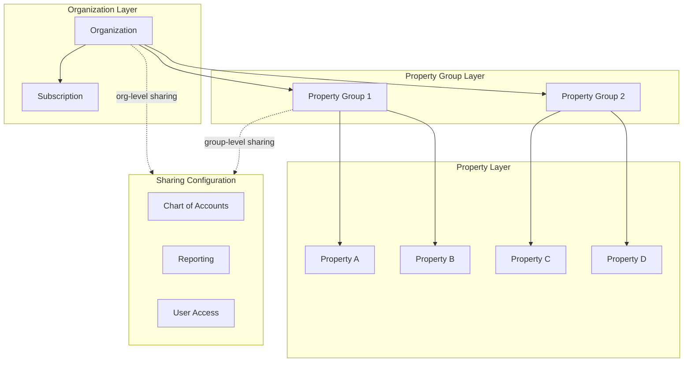
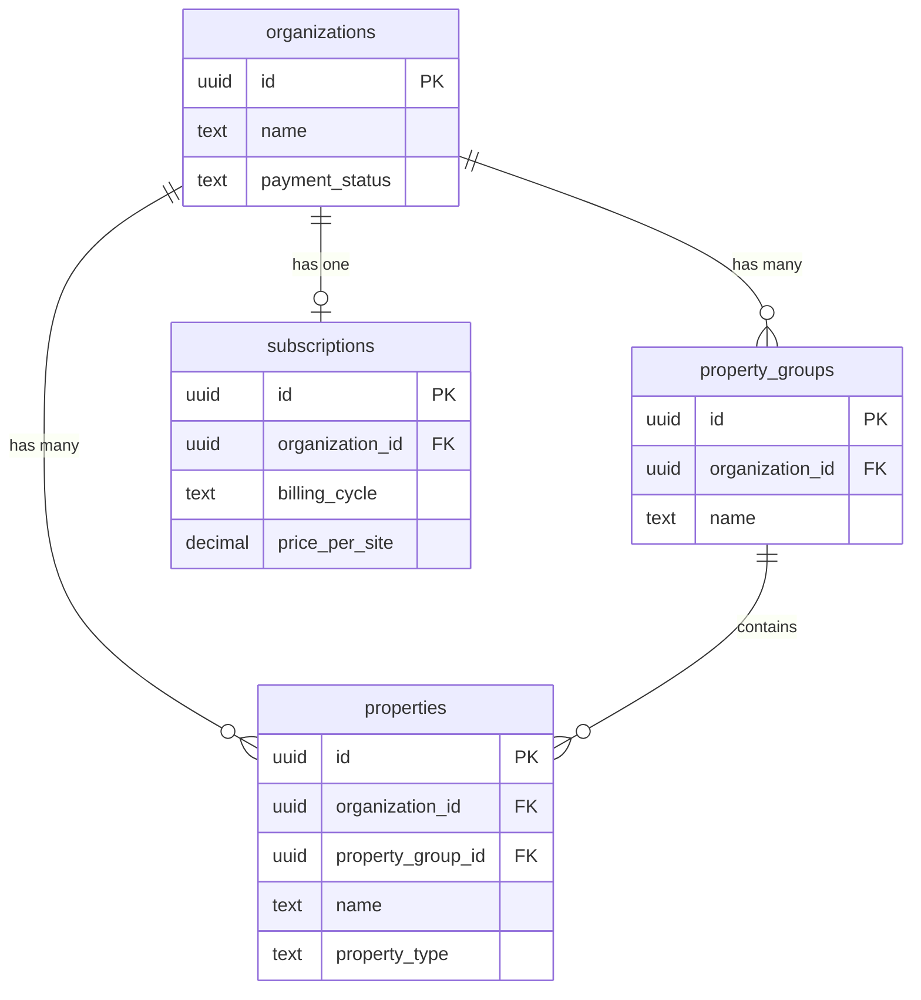

# Property & Organization Module

## Overview

The Property & Organization Module forms the foundational layer of the Happy Camper BnB PMS. It manages the multi-tenant architecture, allowing multiple organizations (companies/brands) to operate multiple properties (hotels, RV parks, campgrounds) within a single system. This module handles property configuration, organizational hierarchy, billing subscriptions, and cross-property sharing settings.

---

## Level 1: Capabilities

1. **Organization Management** - Create and manage top-level tenant entities representing companies or brands
2. **Property Configuration** - Configure individual hotel or campground properties with their settings
3. **Multi-Property Hierarchy** - Organize properties into groups with shared settings
4. **Subscription & Billing** - Manage billing cycles, pricing, and account suspension
5. **Cross-Property Sharing** - Enable sharing of charts of accounts, reporting, and user access across properties

---

## Level 2: Features

### 1. Organization Management
- Create new organizations with unique identifiers
- Set organization-wide billing email for invoicing
- Configure organization-level sharing preferences (chart of accounts, reporting, user access)
- Track organization payment status (active, suspended)
- View all properties and property groups under an organization

### 2. Property Configuration
- **Basic Information**
  - Property name, address, and contact details (phone, email, website)
  - Country and timezone configuration
  - Property type selection (campground or hotel)
  - Customer ID for external system integration
  
- **Inventory Settings**
  - Inventory mode configuration (unit_required vs type_floating)
  - Maximum sites/rooms limit
  - Current audit date management
  
- **Map Configuration**
  - Property map image upload
  - Map dimensions (width/height in pixels)
  
- **Payment Gateway Settings**
  - Payment gateway mode (mock, test, live)
  - Adyen merchant account configuration
  - Adyen client key for frontend integration
  
- **Security Policies**
  - MFA requirement toggle
  - Session timeout configuration (minutes)
  - Password policy settings (min length, uppercase, numbers, special chars)
  - Password rotation period (days)
  - Failed login attempt threshold
  - Account lockout duration

### 3. Multi-Property Hierarchy
- Create property groups within an organization
- Assign properties to groups
- Configure group-level sharing settings:
  - Share chart of accounts across group
  - Share reporting across group
  - Share user access across group
- Move properties between groups

### 4. Subscription & Billing
- Define billing cycle (monthly, annual)
- Set price per site/room
- Configure maximum site allowance
- Suspend accounts with reason tracking
- Reactivate suspended accounts
- Track subscription creation and modification timestamps

### 5. Cross-Property Sharing
- Enable organization-wide chart of accounts sharing
- Configure shared reporting across all properties
- Allow users to access multiple properties within the organization
- Set up guest sharing groups for cross-property guest profile access

---

## Database Tables

| Table | Purpose |
|-------|---------|
| `organizations` | Top-level tenant entity representing a company/brand |
| `property_groups` | Grouping of properties for shared settings |
| `properties` | Individual hotel/campground property configuration |
| `subscriptions` | Organization billing and subscription management |

### Table Details

#### organizations
| Column | Type | Description |
|--------|------|-------------|
| `id` | uuid | Primary key |
| `name` | text | Organization name |
| `payment_status` | text | Billing status (active/suspended) |
| `billing_email` | text | Billing contact email |
| `share_chart_of_accounts` | boolean | Share COA across properties |
| `share_reporting` | boolean | Share reports across properties |
| `share_user_access` | boolean | Share users across properties |

#### property_groups
| Column | Type | Description |
|--------|------|-------------|
| `id` | uuid | Primary key |
| `organization_id` | uuid | FK to organizations |
| `name` | text | Group name |
| `share_chart_of_accounts` | boolean | Share COA in group |
| `share_reporting` | boolean | Share reports in group |
| `share_user_access` | boolean | Share users in group |

#### properties
| Column | Type | Description |
|--------|------|-------------|
| `id` | uuid | Primary key |
| `organization_id` | uuid | FK to organizations |
| `property_group_id` | uuid | FK to property_groups |
| `name` | text | Property name |
| `property_type` | enum | campground or hotel |
| `inventory_mode` | enum | unit_required or type_floating |
| `audit_date` | date | Current business date |
| `payment_gateway_mode` | text | mock, test, or live |
| `require_mfa` | boolean | Require 2FA for users |
| ... | ... | See full schema for all columns |

#### subscriptions
| Column | Type | Description |
|--------|------|-------------|
| `id` | uuid | Primary key |
| `organization_id` | uuid | FK to organizations (unique) |
| `billing_cycle` | text | monthly or annual |
| `price_per_site` | decimal | Price per room/site |
| `max_sites` | integer | Maximum rooms allowed |
| `suspended_at` | timestamptz | Suspension timestamp |
| `suspension_reason` | text | Reason for suspension |

---

## Dataflow

---

## Key Components

### Frontend Components
- `PropertySettings.tsx` - Property configuration page
- `PropertyContext.tsx` - React context for current property state
- `PropertySelector.tsx` - Property switcher component
- `PropertyContactCard.tsx` - Property contact information display

### Admin Pages
- `AdminCustomers.tsx` - Organization management (super admin)
- `AdminProperties.tsx` - Property management (super admin)
- `AdminDashboard.tsx` - Admin overview dashboard

### Database Functions
- `user_can_access_property(_property_id)` - Check property access permission
- `user_has_property_access(_property_id)` - Verify user property access
- `is_org_admin(_organization_id)` - Check org admin status

---

## Enums

### property_type
| Value | Description |
|-------|-------------|
| `campground` | RV park / campground |
| `hotel` | Hotel / motel |

### inventory_mode
| Value | Description |
|-------|-------------|
| `unit_required` | Specific room must be assigned at booking |
| `type_floating` | Room type only, auto-assign at check-in |

---

## Relationships

---

## Security Considerations

1. **Row Level Security (RLS)** - All tables have RLS enabled with property-level isolation
2. **Organization Isolation** - Users can only access properties within their organization
3. **Admin Hierarchy** - Super admins > Org admins > Property admins
4. **Subscription Enforcement** - Suspended organizations cannot access the system
