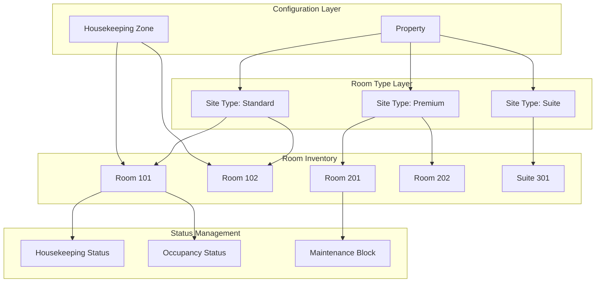
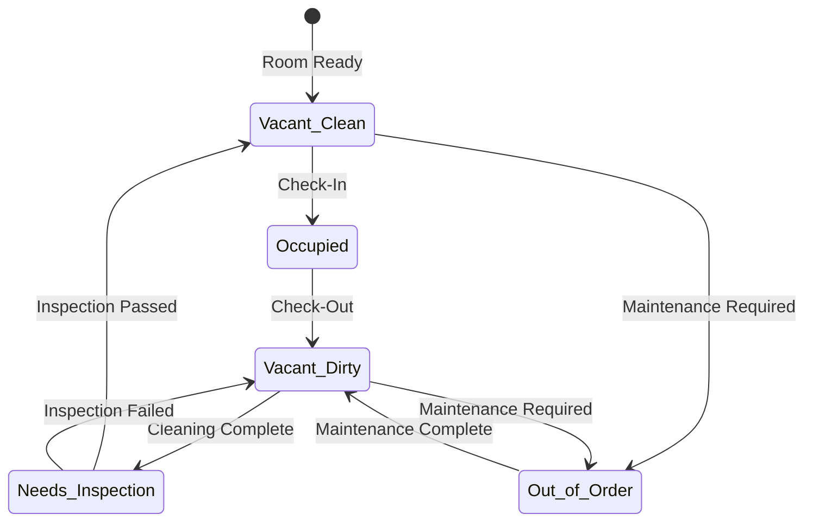
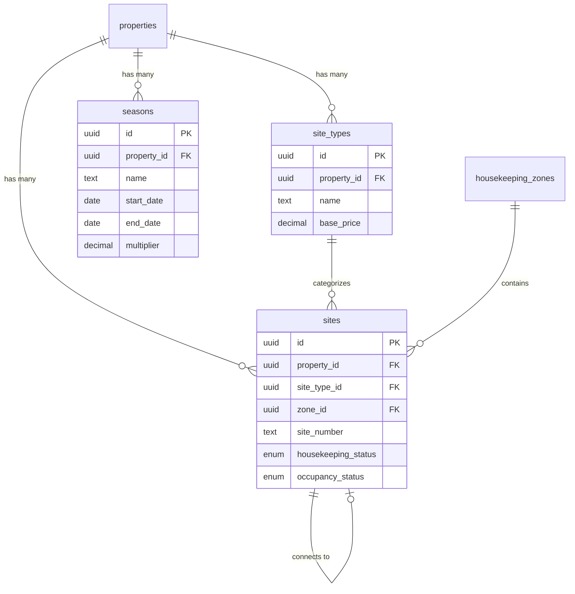

# Site/Room Management Module

## Overview

The Site/Room Management Module handles the physical inventory of a property - the rooms, sites, or units that can be reserved by guests. This module supports both traditional hotel rooms and RV park/campground sites with specialized attributes like hookups, vehicle dimensions, and map positioning. It provides comprehensive room type definitions, amenity management, and visual map-based room layout configuration.

---

## Level 1: Capabilities

1. **Room Type Management** - Define and configure categories of rooms/sites with pricing and attributes
2. **Individual Room/Site Inventory** - Manage individual units with their specific properties
3. **Amenity Configuration** - Define and assign amenities to room types and individual rooms
4. **Visual Map Management** - Position rooms on a property map for visual selection
5. **Availability Management** - Track room status, maintenance periods, and out-of-order situations
6. **Seasonal Configuration** - Define seasonal periods for pricing adjustments

---

## Level 2: Features

### 1. Room Type Management
- **Basic Configuration**
  - Room type name and code (e.g., "DLX" for Deluxe King)
  - Description for guest-facing display
  - Base price (default nightly rate)
  - Display icon selection
  
- **Occupancy Settings**
  - Maximum adult occupancy
  - Maximum child occupancy
  - Total max occupancy calculation
  
- **Physical Attributes**
  - Bed type configuration (King, Queen, Double, etc.)
  - Floor size in square feet
  - Room class categorization
  - Available views (ocean, garden, pool, etc.)
  - Smoking preference policy
  - Wheelchair accessibility flag
  
- **Featured Amenities**
  - Assign key amenities to room types
  - Display priority amenities on booking interface

### 2. Individual Room/Site Inventory
- **Identification**
  - Unique room/site number per property
  - Optional description
  - Floor level assignment
  
- **Capacity & Configuration**
  - Maximum occupancy override
  - Individual amenities (additional to room type)
  - Bed configuration override
  - View type specification
  - ADA accessibility flag
  
- **Status Management**
  - Active/inactive toggle for booking availability
  - Housekeeping status (clean, dirty, needs_inspection, out_of_order)
  - Occupancy status (vacant, occupied)
  - Maintenance status notes
  
- **Room Relationships**
  - Connecting room assignment
  - Housekeeping zone assignment
  
- **RV/Campground Specific**
  - Maximum vehicle length
  - Number of slideouts allowed
  - Towing vehicle parking availability
  - Towed vehicle parking availability
  - Site access type (pull-through, back-in)
  
- **Maintenance Scheduling**
  - Unavailable start date
  - Unavailable end date
  - Unavailability reason

### 3. Amenity Configuration
- Define property-wide amenity lists
- Categorize amenities (in-room, outdoor, service)
- Assign amenities at room type level
- Override/extend amenities at individual room level
- Support for array-based amenity storage

### 4. Visual Map Management
- **Map Setup**
  - Upload property map image
  - Configure map dimensions (width, height)
  
- **Room Positioning**
  - X/Y coordinate placement for each room
  - Icon width and height configuration
  - Rotation angle for proper orientation
  - Drag-and-drop positioning in editor
  
- **Map Display**
  - Color-coded status visualization
  - Interactive room selection
  - Real-time availability overlay

### 5. Availability Management
- **Status Tracking**
  - Real-time occupancy status updates
  - Housekeeping status workflow
  - Out-of-order management
  
- **Maintenance Blocks**
  - Schedule future maintenance periods
  - Automatic booking block during maintenance
  - Reason tracking for maintenance

### 6. Seasonal Configuration
- Define named seasons (Peak, Off-Peak, Holiday)
- Set season date ranges
- Configure price multipliers (e.g., 1.5x for peak season)
- Support overlapping season handling
- Property-wide season definitions

---

## Database Tables

| Table | Purpose |
|-------|---------|
| `site_types` | Room/site category definitions with base pricing |
| `sites` | Individual room/site inventory records |
| `seasons` | Property-wide seasonal period definitions |

### Table Details

#### site_types
| Column | Type | Description |
|--------|------|-------------|
| `id` | uuid | Primary key |
| `property_id` | uuid | FK to properties |
| `name` | text | Type name (e.g., "Deluxe King") |
| `code` | text | Short code (e.g., "DLX") |
| `description` | text | Guest-facing description |
| `base_price` | decimal(10,2) | Default nightly rate |
| `max_adults` | integer | Maximum adult occupancy |
| `max_children` | integer | Maximum child occupancy |
| `bed_type` | text | Bed configuration |
| `floor_size_sqft` | integer | Room size in sq ft |
| `room_class` | text | Room class category |
| `room_views` | text[] | Available views array |
| `featured_amenities` | text[] | Key amenities array |
| `smoking_preference` | text | Smoking policy |
| `is_wheelchair_accessible` | boolean | ADA accessible |
| `icon` | text | Display icon |

#### sites
| Column | Type | Description |
|--------|------|-------------|
| `id` | uuid | Primary key |
| `property_id` | uuid | FK to properties |
| `site_type_id` | uuid | FK to site_types |
| `zone_id` | uuid | FK to housekeeping_zones |
| `site_number` | text | Room number (unique per property) |
| `description` | text | Room description |
| `floor` | text | Floor level |
| `max_occupancy` | integer | Max guests |
| `amenities` | text[] | Room amenities array |
| `bed_config` | text | Bed setup |
| `view_type` | text | Room view |
| `is_active` | boolean | Available for booking |
| `is_ada_accessible` | boolean | ADA compliant |
| `housekeeping_status` | enum | Cleanliness state |
| `occupancy_status` | enum | Occupancy state |
| `maintenance_status` | text | Maintenance notes |
| `connecting_room_id` | uuid | FK to sites (connecting) |
| `map_x` | decimal | Map X coordinate |
| `map_y` | decimal | Map Y coordinate |
| `map_width` | decimal | Icon width on map |
| `map_height` | decimal | Icon height on map |
| `rotation` | decimal | Map rotation angle |
| `max_vehicle_length` | integer | RV length limit |
| `slideouts` | integer | Slideouts allowed |
| `has_towing_vehicle_parking` | boolean | Truck parking |
| `has_towed_vehicle_parking` | boolean | Trailer parking |
| `site_access_type` | text | Pull-through/back-in |
| `unavailable_start_date` | date | Maintenance start |
| `unavailable_end_date` | date | Maintenance end |
| `unavailable_reason` | text | Reason for unavailability |

#### seasons
| Column | Type | Description |
|--------|------|-------------|
| `id` | uuid | Primary key |
| `property_id` | uuid | FK to properties |
| `name` | text | Season name |
| `start_date` | date | Season start |
| `end_date` | date | Season end |
| `multiplier` | decimal(5,2) | Price multiplier |

---

## Dataflow

### Room Status Flow

---

## Key Components

### Frontend Pages
- `RoomSettings.tsx` - Room type and room configuration page
- `SiteMaintenance.tsx` - Room turnover and maintenance management
- `Map.tsx` - Visual property map display
- `MapEditor.tsx` - Map positioning editor

### Frontend Components
- `SiteFormDialog.tsx` - Create/edit room dialog

### Database Indexes
- `idx_sites_property` - Property-based site lookup
- `idx_sites_type` - Site type filtering

---

## Enums

### housekeeping_status
| Value | Description |
|-------|-------------|
| `clean` | Room is clean and ready |
| `dirty` | Room needs cleaning |
| `needs_inspection` | Cleaned, awaiting inspection |
| `out_of_order` | Not available for use |

### occupancy_status
| Value | Description |
|-------|-------------|
| `vacant` | Room is empty |
| `occupied` | Guest currently in room |

---

## Relationships

---

## Integration Points

1. **Reservation Module** - Sites are referenced by reservations for room assignment
2. **Housekeeping Module** - Manages cleaning status and zone assignments
3. **Rate Module** - Room types linked to rate pricing
4. **Night Audit** - Updates housekeeping status during day-end processing
5. **Map Display** - Visual room selection for front desk operations
