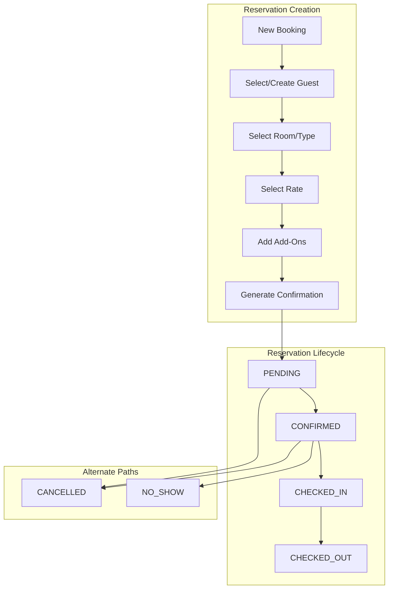
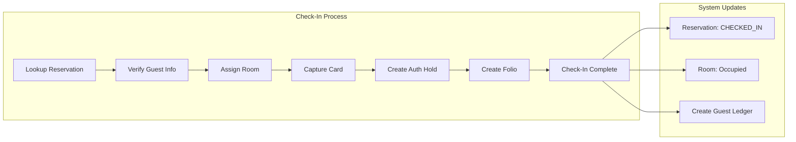
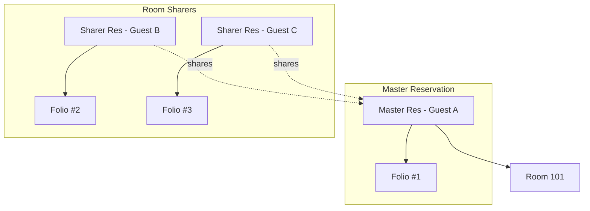
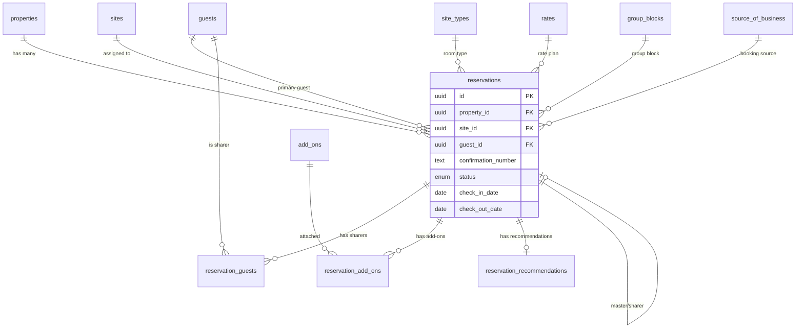

# Reservation Management Module

## Overview

The Reservation Management Module is the core operational module of the PMS, handling the complete guest stay lifecycle from initial booking through check-out. It supports individual reservations, shared room occupancy, group block bookings, and provides AI-powered recommendations for upselling. The module integrates with rate management, guest profiles, and accounting to create a seamless front desk experience.

---

## Level 1: Capabilities

1. **Reservation Creation** - Create new bookings with guest, room, and rate selection
2. **Reservation Lifecycle** - Manage status transitions from pending through check-out
3. **Room Assignment** - Assign and manage room allocations with auto-assignment support
4. **Guest Check-In/Check-Out** - Process arrivals and departures with folio creation
5. **Shared Occupancy** - Support multiple guests sharing a single room
6. **Add-On Management** - Attach ancillary products and services to reservations
7. **AI Recommendations** - Generate intelligent site and add-on recommendations
8. **Source Tracking** - Track booking sources for marketing analysis

---

## Level 2: Features

### 1. Reservation Creation
- **Booking Flow**
  - Property and date selection
  - Room type or specific room selection
  - Guest profile lookup or creation
  - Rate plan selection with pricing display
  - Add-on attachment
  - Special requests capture
  - Quote generation with tax calculation
  
- **Confirmation**
  - Auto-generated confirmation numbers
  - Confirmation sequence per property
  - Email confirmation sending
  - Booking summary display

### 2. Reservation Lifecycle
- **Status Management**
  - PENDING - Awaiting confirmation
  - CONFIRMED - Confirmed, awaiting arrival
  - CHECKED_IN - Guest is in-house
  - CHECKED_OUT - Guest has departed
  - CANCELLED - Reservation cancelled
  - NO_SHOW - Guest did not arrive
  
- **Modifications**
  - Date changes (extend/shorten stay)
  - Room moves (change room assignment)
  - Rate changes (upgrade/downgrade)
  - Guest count adjustments
  - Override rate capability

### 3. Room Assignment
- **Assignment Modes**
  - Unit Required - Room assigned at booking
  - Type Floating - Room type only, assign at check-in
  
- **Auto-Assignment**
  - Algorithm-based room selection
  - Consider room preferences
  - Optimize housekeeping efficiency
  - Assignment lock to prevent changes
  
- **Manual Assignment**
  - Drag-and-drop on booking chart
  - Room availability validation
  - Conflict detection and resolution

### 4. Guest Check-In/Check-Out
- **Check-In Process**
  - Reservation lookup (confirmation number, guest name)
  - Guest information verification
  - Room assignment confirmation
  - Payment card capture
  - Authorization hold creation
  - Guest folio creation
  - Key card generation support
  
- **Check-Out Process**
  - Folio balance review
  - Outstanding charges settlement
  - Payment processing
  - Receipt generation
  - Room status update to dirty
  - Folio closure

### 5. Shared Occupancy (Room Sharers)
- **Multi-Guest Rooms**
  - Master reservation designation
  - Add sharer guests to existing reservation
  - Individual guest confirmation numbers
  - Separate folio per sharer
  - Folio number sequencing (1, 2, 3...)
  
- **Sharing Configuration**
  - Share group identification
  - Primary guest designation
  - Individual check-in/check-out support
  - Charge routing between sharers

### 6. Add-On Management
- **Reservation Add-Ons**
  - Attach add-ons at booking time
  - Add during stay
  - Quantity specification
  - Price locked at booking time
  - Automatic folio posting (nightly/one-time)

### 7. AI Recommendations
- **Site Recommendations**
  - Analyze guest preferences
  - Consider past stay history
  - Recommend alternative sites
  - Score-based ranking with reasons
  
- **Add-On Recommendations**
  - Suggest relevant add-ons
  - Personalized based on guest profile
  - Upsell opportunity identification

### 8. Source Tracking
- **Source of Business**
  - Define booking sources (Direct, OTA, Phone, Walk-in)
  - Assign source to each reservation
  - Default source configuration
  - Source-based reporting and analytics

---

## Database Tables

| Table | Purpose |
|-------|---------|
| `reservations` | Core reservation records |
| `reservation_guests` | Multiple guests per reservation (sharers) |
| `reservation_add_ons` | Add-ons attached to reservations |
| `reservation_recommendations` | AI-generated recommendations |
| `source_of_business` | Booking source definitions |
| `property_confirmation_sequences` | Confirmation number generation |

### Table Details

#### reservations
| Column | Type | Description |
|--------|------|-------------|
| `id` | uuid | Primary key |
| `property_id` | uuid | FK to properties |
| `site_id` | uuid | FK to sites (assigned room) |
| `site_type_id` | uuid | FK to site_types (floating mode) |
| `guest_id` | uuid | FK to guests (primary guest) |
| `rate_id` | uuid | FK to rates |
| `group_block_id` | uuid | FK to group_blocks |
| `source_of_business_id` | uuid | FK to source_of_business |
| `city_ledger_account_id` | uuid | FK for direct billing |
| `master_reservation_id` | uuid | FK for share groups |
| `share_group_id` | uuid | Share group identifier |
| `confirmation_number` | text | Unique confirmation code |
| `check_in_date` | date | Arrival date |
| `check_out_date` | date | Departure date |
| `status` | enum | Reservation status |
| `total_price` | decimal | Total reservation amount |
| `override_rate` | decimal | Manual rate override |
| `guests_count` | integer | Total guests |
| `adults_count` | integer | Number of adults |
| `children_count` | integer | Number of children |
| `special_requests` | text | Guest requests |
| `billing_instructions` | text | Billing notes |
| `is_share_master` | boolean | Is master of share group |
| `assignment_locked` | boolean | Prevent auto-assignment |

#### reservation_guests
| Column | Type | Description |
|--------|------|-------------|
| `id` | uuid | Primary key |
| `reservation_id` | uuid | FK to reservations |
| `guest_id` | uuid | FK to guests |
| `guest_confirmation_number` | text | Individual confirmation |
| `folio_number` | integer | Folio sequence (1, 2, 3...) |
| `is_primary` | boolean | Primary guest flag |

#### reservation_add_ons
| Column | Type | Description |
|--------|------|-------------|
| `id` | uuid | Primary key |
| `reservation_id` | uuid | FK to reservations |
| `add_on_id` | uuid | FK to add_ons |
| `quantity` | integer | Number of units |
| `price_at_booking` | decimal | Locked-in price |

#### reservation_recommendations
| Column | Type | Description |
|--------|------|-------------|
| `id` | uuid | Primary key |
| `reservation_id` | uuid | FK to reservations |
| `recommended_sites` | jsonb | Array of site recommendations |
| `recommended_add_on` | jsonb | Suggested add-on |

#### source_of_business
| Column | Type | Description |
|--------|------|-------------|
| `id` | uuid | Primary key |
| `property_id` | uuid | FK to properties |
| `code` | text | Source code |
| `definition` | text | Source description |
| `is_default` | boolean | Default selection |

---

## Dataflow

### Reservation Lifecycle Flow

### Check-In Process Flow

### Shared Room Flow

---

## Key Components

### Frontend Pages
- `Reservations.tsx` - Reservation list and search
- `BookingChart.tsx` - Visual booking grid (tape chart)
- `Book.tsx` - New reservation booking flow
- `Confirm.tsx` - Booking confirmation page
- `CheckIn.tsx` - Check-in processing
- `InHouseGuests.tsx` - In-house guest list
- `ReservationEdit.tsx` - Modify existing reservation
- `ReservationSettings.tsx` - Reservation configuration

### Frontend Components
- `BookingStepDetails.tsx` - Booking date/guest step
- `BookingStepGuest.tsx` - Guest selection step
- `BookingStepSite.tsx` - Room selection step
- `QuoteSummaryCard.tsx` - Price quote display
- `AutoAssignDialog.tsx` - Auto-assignment configuration
- `AddSharerDialog.tsx` - Add room sharers
- `ShareGroupCard.tsx` - Shared room display

### Edge Functions
- `get-recommendations` - AI-powered site and add-on recommendations

### Hooks
- `useBookingData.ts` - Booking data management
- `useBookingForm.ts` - Booking form state
- `useQuoteCalculation.ts` - Price calculation
- `useReservationMutation.ts` - Reservation CRUD operations
- `useReservationGuests.ts` - Sharer management
- `useSharedReservations.ts` - Shared room handling

---

## Enums

### reservation_status
| Value | Description |
|-------|-------------|
| `PENDING` | Awaiting confirmation |
| `CONFIRMED` | Confirmed, awaiting arrival |
| `CHECKED_IN` | Guest is in-house |
| `CHECKED_OUT` | Guest has departed |
| `CANCELLED` | Reservation cancelled |
| `NO_SHOW` | Guest did not arrive |

---

## Relationships

---

## Integration Points

1. **Guest Module** - Guest profile lookup and creation
2. **Rate Module** - Rate plan selection and pricing
3. **Site Module** - Room availability and assignment
4. **Accounting Module** - Folio creation at check-in
5. **Payment Module** - Card capture and authorization
6. **Housekeeping Module** - Room status updates
7. **Group Blocks** - Block room allocation
8. **CRM Module** - Campaign trigger based on reservation events
