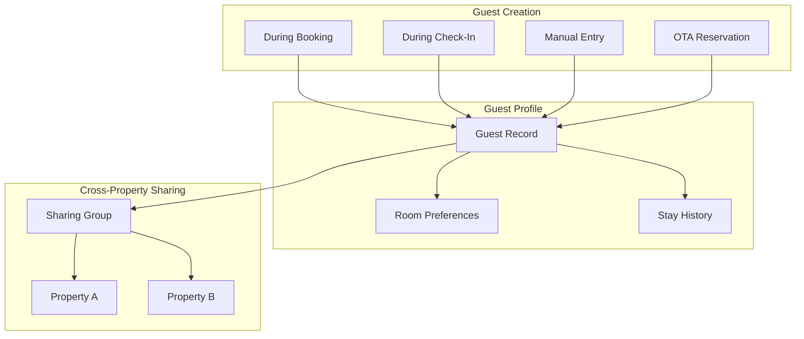
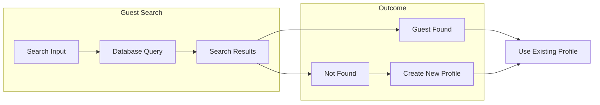
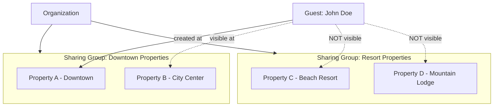
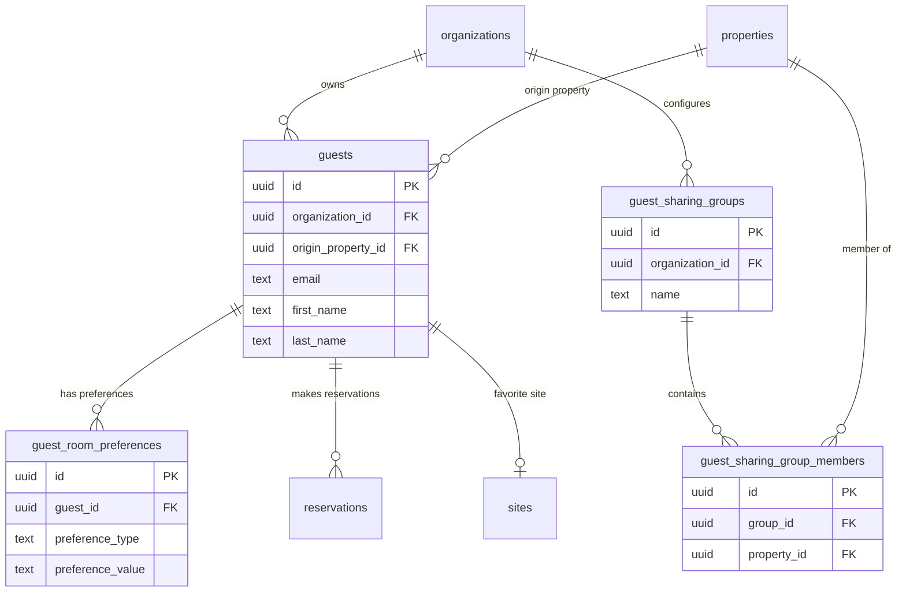

# Guest Management Module

## Overview

The Guest Management Module maintains comprehensive guest profiles that persist across multiple stays and properties within an organization. It captures personal information, preferences, and stay history to enable personalized service and targeted marketing. The module supports cross-property guest sharing, allowing organizations with multiple properties to recognize returning guests regardless of which property they visit.

---

## Level 1: Capabilities

1. **Guest Profile Management** - Create and maintain comprehensive guest profiles
2. **Room Preferences** - Track and apply guest room preferences
3. **Stay History** - View complete history of guest stays across properties
4. **Cross-Property Sharing** - Share guest profiles across properties within an organization
5. **Guest Lookup** - Search and identify returning guests during booking

---

## Level 2: Features

### 1. Guest Profile Management
- **Personal Information**
  - First name, last name, title/salutation
  - Email address (primary identifier)
  - Primary and secondary phone numbers
  - Full mailing address (street, city, state, zip, country)
  
- **Special Dates**
  - Birthday tracking for special recognition
  - Anniversary date for celebrations
  
- **Preferences**
  - Free-text likes and dislikes notes
  - Favorite site/room assignment
  
- **Profile Origin**
  - Track which property originally created the guest
  - Organization-wide guest identification

### 2. Room Preferences
- **Preference Types**
  - Floor preference (high/low)
  - View preference (ocean, garden, pool, etc.)
  - Bed type preference
  - Accessibility requirements
  - Smoking/non-smoking preference
  - Quiet room requests
  
- **Preference Application**
  - Auto-apply during room assignment
  - Preference matching score for recommendations
  - Override capability for special requests

### 3. Stay History
- **Historical Records**
  - All past reservations across properties
  - Check-in and check-out dates
  - Rooms stayed in
  - Total revenue generated
  - Payment history
  
- **Folio History**
  - View closed folios from past stays
  - Transaction detail access
  - Receipt reprinting
  
- **Statistics**
  - Total number of stays
  - Total nights stayed
  - Lifetime value calculation
  - Average spend per stay

### 4. Cross-Property Sharing
- **Sharing Groups**
  - Create named sharing groups within organization
  - Assign properties to sharing groups
  - Control which properties can access guest data
  
- **Sharing Behavior**
  - Shared guests visible across group properties
  - Original profile maintained at origin property
  - Updates synchronized across all properties
  
- **Privacy Controls**
  - Organization-level sharing toggle
  - Property group-level sharing
  - Individual guest opt-out (if implemented)

### 5. Guest Lookup
- **Search Capabilities**
  - Search by email address
  - Search by name (first, last, or both)
  - Search by phone number
  - Search by confirmation number
  
- **Lookup Integration**
  - Embedded in booking flow
  - Available during check-in
  - Profile creation if not found
  
- **Duplicate Detection**
  - Identify potential duplicate profiles
  - Merge duplicate records

---

## Database Tables

| Table | Purpose |
|-------|---------|
| `guests` | Guest profile information |
| `guest_room_preferences` | Room preference records |
| `guest_sharing_groups` | Cross-property sharing group definitions |
| `guest_sharing_group_members` | Properties in each sharing group |

### Table Details

#### guests
| Column | Type | Description |
|--------|------|-------------|
| `id` | uuid | Primary key |
| `organization_id` | uuid | FK to organizations |
| `origin_property_id` | uuid | FK to properties (created at) |
| `email` | text | Email address (unique per org) |
| `first_name` | text | First name |
| `last_name` | text | Last name |
| `title` | text | Salutation (Mr, Mrs, etc.) |
| `phone` | text | Primary phone |
| `phone2` | text | Secondary phone |
| `street_address` | text | Street address |
| `city` | text | City |
| `state` | text | State/province |
| `zipcode` | text | Postal code |
| `country` | text | Country |
| `birthday` | date | Birth date |
| `anniversary` | date | Anniversary date |
| `likes_dislikes` | text | Preference notes |
| `favorite_site_id` | uuid | FK to sites |
| `created_at` | timestamptz | Profile creation time |
| `updated_at` | timestamptz | Last update time |

#### guest_room_preferences
| Column | Type | Description |
|--------|------|-------------|
| `id` | uuid | Primary key |
| `guest_id` | uuid | FK to guests |
| `preference_type` | text | Type of preference |
| `preference_value` | text | Preference value |
| `created_at` | timestamptz | Creation timestamp |

#### guest_sharing_groups
| Column | Type | Description |
|--------|------|-------------|
| `id` | uuid | Primary key |
| `organization_id` | uuid | FK to organizations |
| `name` | text | Group name |
| `created_at` | timestamptz | Creation timestamp |
| `updated_at` | timestamptz | Last update time |

#### guest_sharing_group_members
| Column | Type | Description |
|--------|------|-------------|
| `id` | uuid | Primary key |
| `group_id` | uuid | FK to guest_sharing_groups |
| `property_id` | uuid | FK to properties |
| `created_at` | timestamptz | Creation timestamp |

---

## Dataflow

### Guest Lifecycle

### Guest Lookup Flow

### Cross-Property Sharing

---

## Key Components

### Frontend Pages
- `GuestProfiles.tsx` - Guest list and search page
- `GuestProfile.tsx` - Individual guest profile view/edit
- `GuestHistory.tsx` - Guest stay history with closed folios

### Frontend Components
- `GuestLookup.tsx` - Guest search component for booking/check-in
- `GuestSharingSettings.tsx` - Configure cross-property sharing

### Hooks
- `useReservationGuests.ts` - Manage guests on reservations

### Database Functions
- `can_access_guest(_guest_id, _property_id)` - Check if property can access a guest profile

---

## Relationships

---

## Integration Points

1. **Reservation Module** - Guest selection during booking, sharer management
2. **Accounting Module** - Guest information on folios and invoices
3. **CRM Module** - Campaign targeting based on guest data
4. **Payment Module** - Card storage linked to guest profiles
5. **Check-In Module** - Guest verification and preference application
6. **Reports Module** - Guest statistics and lifetime value reporting

---

## Privacy & Data Considerations

1. **Data Ownership** - Guests are owned at organization level, not property level
2. **Sharing Controls** - Fine-grained control over cross-property visibility
3. **Profile Merging** - Capability to merge duplicate profiles
4. **Data Retention** - Guest profiles persist across stays for recognition
5. **GDPR Considerations** - Structure supports data portability and deletion requests
