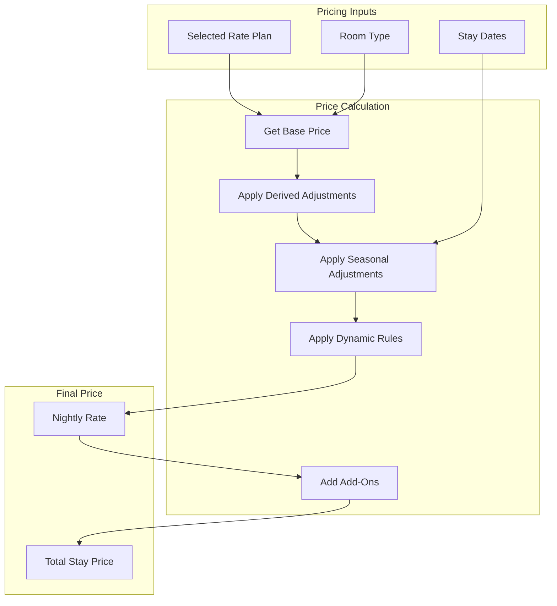
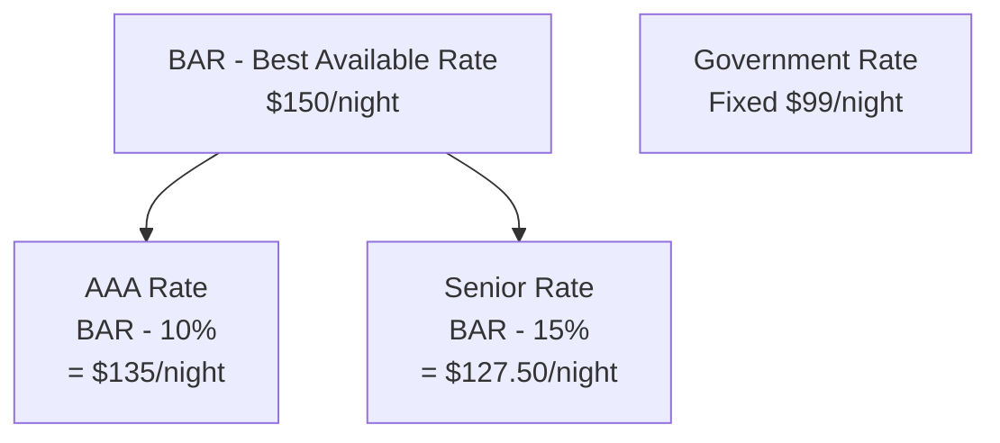
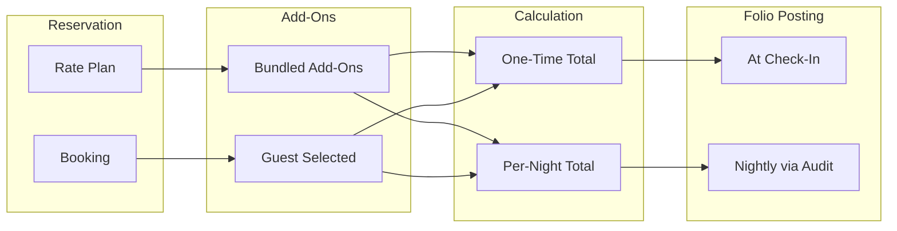
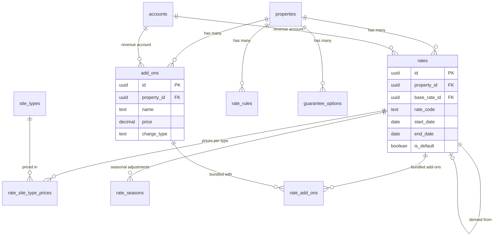

# Rate & Pricing Module

## Overview

The Rate & Pricing Module provides comprehensive rate management capabilities for the PMS. It supports complex pricing scenarios including base rates, derived rates, seasonal adjustments, room type-specific pricing, and dynamic pricing rules. The module also manages add-on products/services and guarantee types that can be attached to reservations.

---

## Level 1: Capabilities

1. **Rate Plan Management** - Define and manage rate plans with flexible pricing structures
2. **Seasonal Pricing** - Configure seasonal price adjustments within rate plans
3. **Room Type Pricing** - Set per-room-type prices for each rate plan
4. **Dynamic Pricing Rules** - Apply automatic price adjustments based on conditions
5. **Add-On Management** - Configure ancillary products and services
6. **Guarantee Types** - Define reservation guarantee requirements
7. **Rate-Add-On Bundles** - Package add-ons with specific rate plans

---

## Level 2: Features

### 1. Rate Plan Management
- **Rate Definition**
  - Unique rate code (e.g., "BAR", "AAA", "GOV")
  - Descriptive name
  - Effective date range (start and end dates)
  - Default rate designation
  - Revenue account assignment for GL posting
  
- **Rate Types**
  - Base rates - Standalone pricing
  - Derived rates - Based on another rate with adjustment
  
- **Derived Rate Configuration**
  - Parent rate selection (base_rate_id)
  - Adjustment type (percentage or fixed)
  - Adjustment value (e.g., -10% or -$25)
  
- **Deposit Requirements**
  - None - No deposit required
  - First night - First night deposit
  - Full stay - Full prepayment required
  - Percentage - Custom percentage of total

### 2. Seasonal Pricing
- **Season Definition per Rate**
  - Season name (e.g., "Summer Peak", "Winter Off-Peak")
  - Date range within rate validity
  - Price multiplier (e.g., 1.5x for peak)
  
- **Adjustment Methods**
  - Percentage adjustment
  - Fixed amount adjustment
  - Multiplier-based
  
- **Season Stacking**
  - Multiple seasons per rate plan
  - Non-overlapping date enforcement
  - Automatic season detection during booking

### 3. Room Type Pricing
- **Per-Type Configuration**
  - Specific price per room type per rate
  - Override base room type pricing
  - Support for all room types in property
  
- **Type-Level Adjustments**
  - Additional adjustment type per room type
  - Additional adjustment value
  - Layered with rate-level and seasonal adjustments

### 4. Dynamic Pricing Rules
- **Rule Configuration**
  - Rule name and type
  - JSON-based conditions
  - Multiplier or discount amount
  
- **Rule Types**
  - Weekend pricing (Fri-Sat premium)
  - Length of stay discounts
  - Early bird discounts
  - Last-minute pricing
  - Occupancy-based pricing
  
- **Condition Examples**
  ```json
  {
    "day_of_week": ["friday", "saturday"],
    "min_los": 3,
    "booking_window_days": 30
  }
  ```

### 5. Add-On Management
- **Add-On Definition**
  - Name and optional code
  - Description
  - Price
  - Revenue account assignment
  - Category grouping
  
- **Charge Types**
  - One-time - Charged once per reservation
  - Nightly - Charged each night of stay
  
- **Add-On Status**
  - Active/inactive toggle
  - Category-based organization
  
- **Examples**
  - Breakfast package (nightly)
  - Parking (nightly)
  - Pet fee (one-time)
  - Late checkout (one-time)

### 6. Guarantee Types
- **Guarantee Definition**
  - Code and description
  - Sort order for display
  - Active/inactive status
  
- **Common Guarantee Types**
  - Credit Card Guarantee
  - Advance Deposit
  - Company Direct Bill
  - Travel Agent Voucher

### 7. Rate-Add-On Bundles
- **Package Configuration**
  - Link add-ons to specific rate plans
  - Auto-attach add-ons when rate selected
  - Included vs. optional add-ons
  
- **Bundle Pricing**
  - Bundled add-ons at reduced/free rate
  - Value-add packages (e.g., "Romance Package" with champagne)

---

## Database Tables

| Table | Purpose |
|-------|---------|
| `rates` | Rate plan definitions |
| `rate_site_type_prices` | Per-room-type pricing for rates |
| `rate_seasons` | Seasonal adjustments within rates |
| `rate_add_ons` | Add-ons bundled with rates |
| `rate_rules` | Dynamic pricing rules |
| `add_ons` | Ancillary products/services |
| `guarantee_options` | Reservation guarantee types |

### Table Details

#### rates
| Column | Type | Description |
|--------|------|-------------|
| `id` | uuid | Primary key |
| `property_id` | uuid | FK to properties |
| `base_rate_id` | uuid | FK to rates (for derived rates) |
| `revenue_account_id` | uuid | FK to accounts (for GL posting) |
| `rate_code` | text | Unique rate code |
| `description` | text | Rate description |
| `start_date` | date | Effective start date |
| `end_date` | date | Effective end date |
| `is_default` | boolean | Default rate for property |
| `is_base_rate` | boolean | Is a base rate (can be derived from) |
| `deposit_requirement` | text | Deposit policy |
| `adjustment_type` | text | 'percentage' or 'fixed' |
| `adjustment_value` | decimal | Adjustment amount |

#### rate_site_type_prices
| Column | Type | Description |
|--------|------|-------------|
| `id` | uuid | Primary key |
| `rate_id` | uuid | FK to rates |
| `site_type_id` | uuid | FK to site_types |
| `price` | decimal(10,2) | Nightly price |
| `adjustment_type` | text | Override adjustment type |
| `adjustment_value` | decimal | Override adjustment value |

#### rate_seasons
| Column | Type | Description |
|--------|------|-------------|
| `id` | uuid | Primary key |
| `rate_id` | uuid | FK to rates |
| `season_name` | text | Season name |
| `start_date` | date | Season start |
| `end_date` | date | Season end |
| `multiplier` | decimal(5,2) | Price multiplier |
| `adjustment_type` | text | Adjustment type |
| `adjustment_value` | decimal | Adjustment value |

#### rate_add_ons
| Column | Type | Description |
|--------|------|-------------|
| `id` | uuid | Primary key |
| `rate_id` | uuid | FK to rates |
| `add_on_id` | uuid | FK to add_ons |

#### rate_rules
| Column | Type | Description |
|--------|------|-------------|
| `id` | uuid | Primary key |
| `property_id` | uuid | FK to properties |
| `name` | text | Rule name |
| `rule_type` | text | Rule type |
| `conditions` | jsonb | Rule conditions |
| `multiplier` | decimal(5,2) | Price multiplier |
| `discount_amount` | decimal(10,2) | Fixed discount |

#### add_ons
| Column | Type | Description |
|--------|------|-------------|
| `id` | uuid | Primary key |
| `property_id` | uuid | FK to properties |
| `account_id` | uuid | FK to accounts |
| `name` | text | Add-on name |
| `code` | text | Short code |
| `description` | text | Description |
| `price` | decimal(10,2) | Price |
| `charge_type` | text | 'one_time' or 'nightly' |
| `category` | text | Category |
| `is_active` | boolean | Available for sale |

#### guarantee_options
| Column | Type | Description |
|--------|------|-------------|
| `id` | uuid | Primary key |
| `property_id` | uuid | FK to properties |
| `code` | text | Guarantee code |
| `description` | text | Description |
| `sort_order` | integer | Display order |
| `is_active` | boolean | Active |

---

## Dataflow

### Rate Calculation Flow



### Derived Rate Hierarchy



### Add-On Processing



---

## Key Components

### Frontend Pages
- `Rates.tsx` - Rate management page with full rate configuration

### Library Functions
- `taxCalculations.ts` - Tax calculation utilities

### Hooks
- `useQuoteCalculation.ts` - Calculate reservation quotes with all adjustments

---

## Relationships



---

## Pricing Examples

### Example 1: Base Rate with Seasonal Adjustment

```
Rate: BAR (Best Available Rate)
Room Type: Deluxe King
Base Price: $150/night

Season: Summer Peak (Jun 1 - Aug 31)
Multiplier: 1.5x

Calculation:
- Winter stay: $150/night
- Summer stay: $150 × 1.5 = $225/night
```

### Example 2: Derived Rate

```
Base Rate: BAR = $150/night
Derived Rate: AAA
Adjustment: -10%

Calculation:
- AAA Rate: $150 × 0.90 = $135/night
- Summer AAA: $225 × 0.90 = $202.50/night
```

### Example 3: Dynamic Rule

```
Rule: Weekend Premium
Conditions: {"day_of_week": ["friday", "saturday"]}
Multiplier: 1.25

Regular Wednesday: $150/night
Friday with rule: $150 × 1.25 = $187.50/night
```

---

## Integration Points

1. **Reservation Module** - Rate selection during booking, price calculation
2. **Accounting Module** - Revenue account assignment for GL posting
3. **Night Audit** - Nightly add-on posting
4. **Group Blocks** - Override rates for group bookings
5. **OTA API** - Rate availability for external channels
