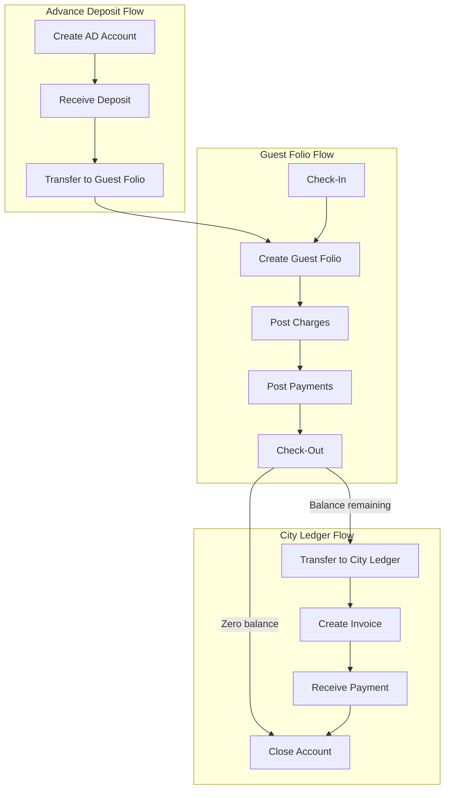
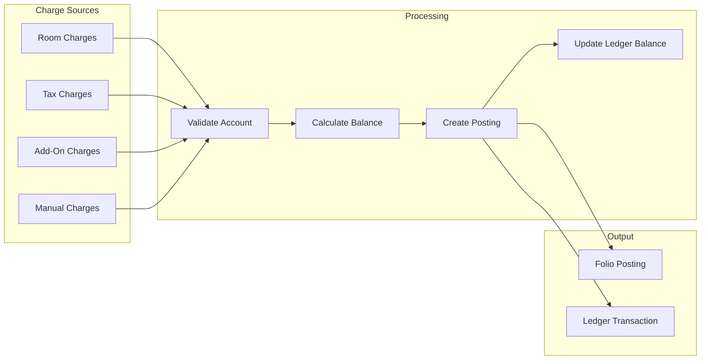
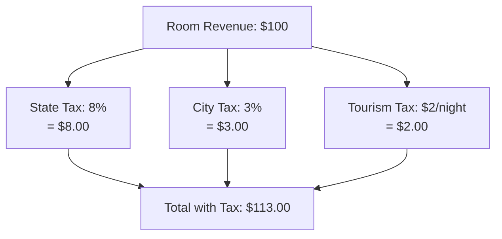
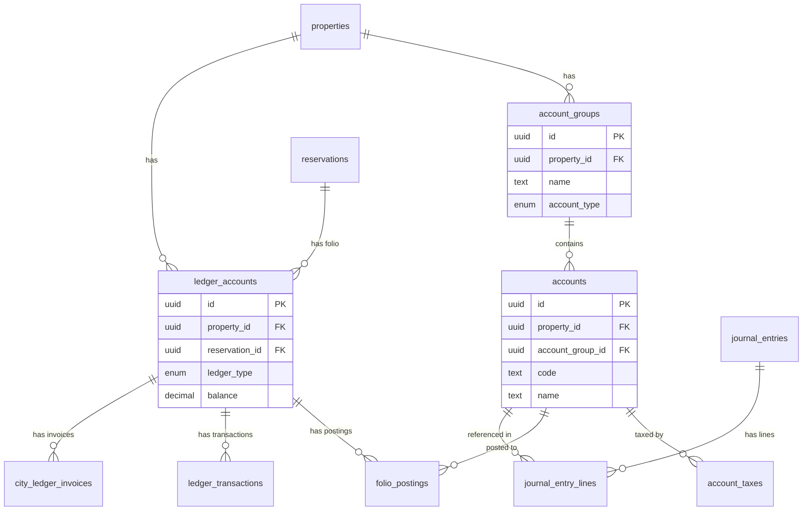

# Accounting Module

## Overview

The Accounting Module provides comprehensive financial management capabilities for the PMS. It implements a full Chart of Accounts, manages three types of ledger accounts (Advance Deposit, Guest Folio, City Ledger), handles transaction posting, and supports journal entries for complex accounting scenarios. The module integrates with the tax configuration system and provides AR management for city ledger accounts.

---

## Level 1: Capabilities

1. **Chart of Accounts** - Define and manage the general ledger account structure
2. **Tax Configuration** - Configure taxes linked to revenue accounts
3. **Ledger Account Management** - Manage advance deposit, guest, and city ledger accounts
4. **Folio Posting** - Post charges, payments, and adjustments to folios
5. **Transaction Recording** - Track all financial transactions
6. **City Ledger (AR)** - Manage accounts receivable with invoicing
7. **Journal Entries** - Create manual GL entries for complex scenarios
8. **Folio Splitting** - Configure charge splitting between multiple folios

---

## Level 2: Features

### 1. Chart of Accounts
- **Account Groups**
  - Organize accounts into groups by type
  - Define sort order for display
  - Support standard account types:
    - Asset
    - Liability
    - Equity
    - Revenue
    - Expense
    - Tax
  
- **Individual Accounts**
  - Unique account code per property
  - Account name and description
  - Normal balance (debit or credit)
  - Active/inactive status
  - Include in nightly KPIs flag
  - External account code for GL integration
  - Payment type designation for payment accounts

### 2. Tax Configuration
- **Tax Linkage**
  - Link tax accounts to revenue accounts
  - Multiple taxes per revenue account
  - Tax calculation order (sort_order)
  
- **Calculation Types**
  - Percentage of revenue
  - Per night flat fee
  - Per person per night
  
- **Tax-on-Tax Support**
  - Inclusive of another tax (compound taxes)
  - Sequential calculation
  
- **Active/Inactive Control**
  - Enable/disable taxes without deletion

### 3. Ledger Account Management
- **Advance Deposit Ledger**
  - Pre-arrival deposits
  - Automatic creation at deposit receipt
  - Transfer to guest folio at check-in
  
- **Guest Ledger (Folio)**
  - Created at check-in
  - Tracks all in-house charges
  - Running balance calculation
  - Multiple folios per room (sharers)
  - Folio number sequencing
  
- **City Ledger (AR)**
  - Post-checkout balances
  - Company direct billing
  - Credit limit enforcement
  - Payment terms (Net 30, etc.)
  - Comprehensive contact information

### 4. Folio Posting
- **Posting Types**
  - Room charges
  - Tax charges
  - Add-on charges
  - Payments
  - Refunds
  - Adjustments
  - Transfers
  
- **Posting Details**
  - Posting date
  - Description
  - Debit/credit amounts
  - Running balance tracking
  - Posted by user tracking
  - Link to revenue account
  
- **Void Capability**
  - Void incorrect postings
  - Void timestamp and user tracking
  - Linked voided posting reference

### 5. Transaction Recording
- **Transaction Types**
  - Payment
  - Charge
  - Transfer
  - Refund
  - Adjustment
  
- **Transaction Details**
  - Transaction date
  - Debit/credit amounts
  - Running balance
  - Reference number
  - Account code linking
  - Posted by user

### 6. City Ledger (AR) Management
- **Invoice Generation**
  - Create invoices from transferred balances
  - Link to source folio
  - Guest name and room details
  - Original and paid amounts
  - Status tracking (open, partially paid, closed)
  
- **Payment Application**
  - Apply payments to specific invoices
  - Partial payment support
  - Applied by user tracking
  
- **Statement Sending**
  - Generate statement for account
  - Email delivery via edge function
  - Mock mode for testing
  - Send history tracking
  
- **Aging Reports**
  - Current, 30, 60, 90+ day aging
  - Aging visualization chart

### 7. Journal Entries
- **Entry Header**
  - Entry date
  - Description
  - Reference number
  - Posted status
  
- **Line Items**
  - Account selection
  - Debit or credit amount
  - Line description
  - Balance validation (debits = credits)
  
- **Posting Workflow**
  - Draft entries
  - Post to ledger
  - Posted by/at tracking

### 8. Folio Splitting
- **Split Rules**
  - Per-reservation configuration
  - Link to specific revenue account
  - Split type definition
  
- **Split Allocations**
  - Per-sharer allocation percentages
  - Automatic charge distribution
  - Support for complex scenarios

---

## Database Tables

| Table | Purpose |
|-------|---------|
| `account_groups` | Chart of Accounts categories |
| `accounts` | General ledger accounts |
| `account_taxes` | Tax configuration per revenue account |
| `ledger_accounts` | Guest folios and AR accounts |
| `folio_postings` | Transaction postings to folios |
| `ledger_transactions` | Ledger account transactions |
| `journal_entries` | Manual journal entry headers |
| `journal_entry_lines` | Journal entry line items |
| `city_ledger_invoices` | AR invoices |
| `city_ledger_invoice_payments` | Payments applied to invoices |
| `folio_split_rules` | Folio splitting configuration |
| `folio_split_rule_allocations` | Split allocations per guest |
| `statement_sends` | AR statement email log |

### Table Details

#### account_groups
| Column | Type | Description |
|--------|------|-------------|
| `id` | uuid | Primary key |
| `property_id` | uuid | FK to properties |
| `name` | text | Group name |
| `account_type` | enum | Account classification |
| `sort_order` | integer | Display order |

#### accounts
| Column | Type | Description |
|--------|------|-------------|
| `id` | uuid | Primary key |
| `property_id` | uuid | FK to properties |
| `account_group_id` | uuid | FK to account_groups |
| `code` | text | Account code |
| `name` | text | Account name |
| `description` | text | Description |
| `normal_balance` | text | 'debit' or 'credit' |
| `is_active` | boolean | Active status |
| `include_in_nightly_kpis` | boolean | Include in RevPAR |
| `external_account` | text | External GL code |
| `payment_type` | text | Payment method type |

#### account_taxes
| Column | Type | Description |
|--------|------|-------------|
| `id` | uuid | Primary key |
| `property_id` | uuid | FK to properties |
| `revenue_account_id` | uuid | FK to accounts (revenue) |
| `tax_account_id` | uuid | FK to accounts (tax) |
| `inclusive_of_tax_id` | uuid | FK to account_taxes (compound) |
| `rate_value` | decimal | Tax rate |
| `calculation_type` | text | percent/per_night/per_person_per_night |
| `sort_order` | integer | Processing order |
| `is_active` | boolean | Active status |

#### ledger_accounts
| Column | Type | Description |
|--------|------|-------------|
| `id` | uuid | Primary key |
| `property_id` | uuid | FK to properties |
| `reservation_id` | uuid | FK to reservations |
| `reservation_guest_id` | uuid | FK to reservation_guests |
| `guest_id` | uuid | FK to guests |
| `ledger_type` | enum | advance_deposit/guest/city |
| `account_number` | text | Account number |
| `company_name` | text | Company (city ledger) |
| `balance` | decimal | Current balance |
| `credit_limit` | decimal | Credit limit (city ledger) |
| `payment_terms_days` | integer | Net terms |
| `is_active` | boolean | Active/closed |
| `opened_at` | timestamptz | Account opened |
| `closed_at` | timestamptz | Account closed |

#### folio_postings
| Column | Type | Description |
|--------|------|-------------|
| `id` | uuid | Primary key |
| `ledger_account_id` | uuid | FK to ledger_accounts |
| `account_id` | uuid | FK to accounts (revenue/payment) |
| `night_audit_id` | uuid | FK to night_audits |
| `posting_date` | date | Posting date |
| `posting_type` | text | room/tax/payment/etc. |
| `description` | text | Description |
| `amount` | decimal | Amount |
| `debit_amount` | decimal | Debit |
| `credit_amount` | decimal | Credit |
| `running_balance` | decimal | Balance after posting |
| `posted_by` | uuid | User ID |
| `posted_by_name` | text | User name |
| `is_voided` | boolean | Voided flag |
| `voided_at` | timestamptz | Void timestamp |

---

## Dataflow

### Ledger Account Lifecycle

### Posting Flow

### Tax Calculation Flow

---

## Key Components

### Frontend Pages
- `Accounting.tsx` - Main accounting page with tabs

### Frontend Components
- `AccountingReports.tsx` - Accounting reports
- `AdvanceDepositLedger.tsx` - AD ledger management
- `ChartOfAccounts.tsx` - COA configuration
- `CityLedger.tsx` - City ledger (AR) management
- `CityLedgerAgingChart.tsx` - AR aging visualization
- `CityLedgerAgingReport.tsx` - AR aging report
- `CityLedgerInvoices.tsx` - Invoice management
- `CityLedgerPayment.tsx` - AR payment processing
- `CityLedgerStatement.tsx` - Statement generation
- `GuestLedger.tsx` - Guest folio management
- `JournalEntries.tsx` - Manual journal entries
- `TaxConfigDialog.tsx` - Tax configuration

### Edge Functions
- `send-statement` - Email AR statements

### Library Functions
- `taxCalculations.ts` - Tax calculation utilities

---

## Enums

### account_type
| Value | Description |
|-------|-------------|
| `asset` | Assets (Cash, AR, etc.) |
| `liability` | Liabilities (AP, deposits) |
| `equity` | Owner's equity |
| `revenue` | Revenue accounts |
| `expense` | Expense accounts |
| `tax` | Tax liability accounts |

### ledger_type
| Value | Description |
|-------|-------------|
| `advance_deposit` | Prepaid deposits |
| `guest` | In-house guest folio |
| `city` | City ledger (AR) |

### transaction_type
| Value | Description |
|-------|-------------|
| `payment` | Payment received |
| `charge` | Charge posted |
| `transfer` | Balance transfer |
| `refund` | Refund issued |
| `adjustment` | Manual adjustment |

---

## Relationships

---

## Integration Points

1. **Reservation Module** - Folio creation at check-in
2. **Payment Module** - Payment posting to folios
3. **Rate Module** - Revenue account assignment
4. **Night Audit** - Automatic room/tax posting
5. **Reports Module** - Financial reporting
6. **Property Module** - Chart of accounts sharing
