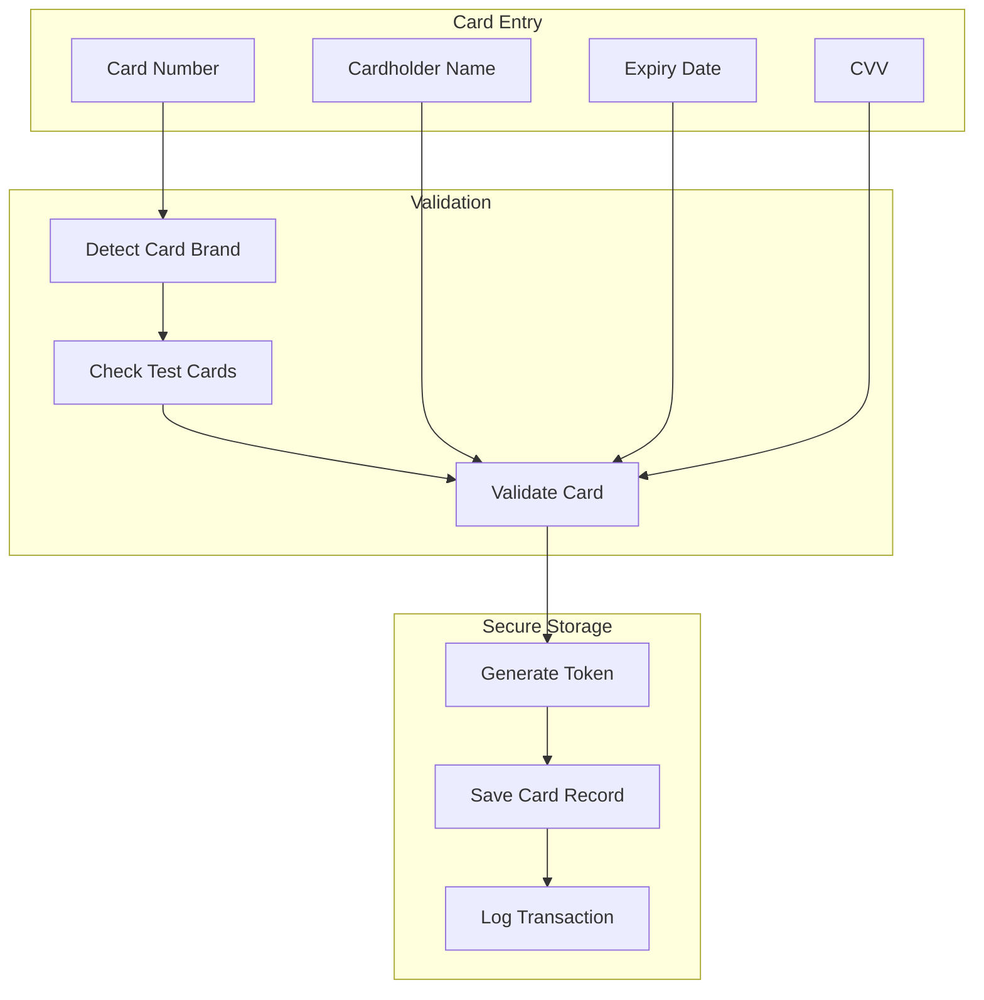
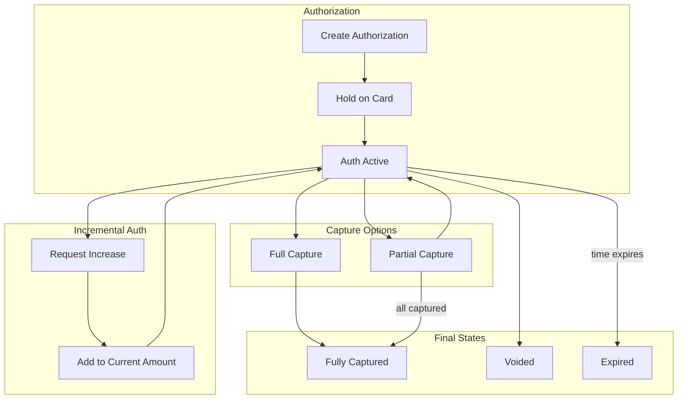
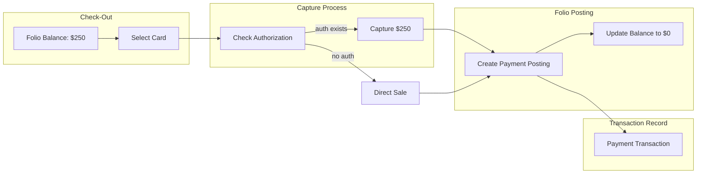
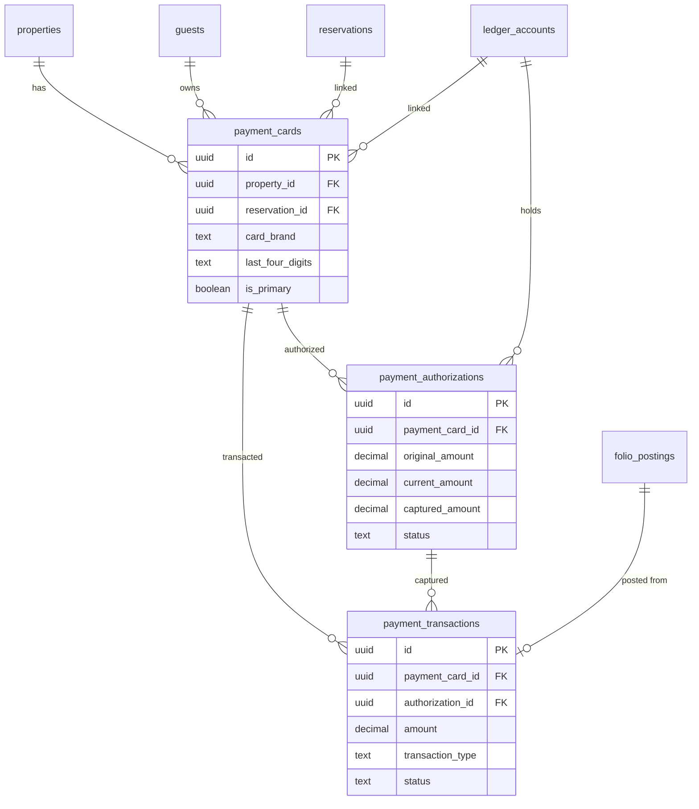

# Payment Processing Module

## Overview

The Payment Processing Module handles all credit card operations including tokenization, authorization holds, captures, refunds, and voids. It supports both a mock mode for testing and real payment processing via Adyen integration. The module implements secure card-on-file storage with PCI-compliant tokenization, authorization management with incremental auth support, and comprehensive transaction logging.

---

## Level 1: Capabilities

1. **Card Tokenization** - Securely store payment cards with PCI-compliant tokens
2. **Authorization Management** - Create and manage authorization holds on cards
3. **Payment Capture** - Capture authorized funds (full or partial)
4. **Sale Transactions** - Direct sale without prior authorization
5. **Refund Processing** - Issue refunds against previous transactions
6. **Void Operations** - Cancel authorizations before capture
7. **Multi-Card Support** - Store and manage multiple cards per reservation

---

## Level 2: Features

### 1. Card Tokenization
- **Card Capture**
  - Secure card number entry
  - Cardholder name
  - Expiry month/year
  - CVV (for verification, not stored)
  
- **Token Generation**
  - PCI-compliant tokenization
  - Card brand detection (Visa, MC, Amex, Discover)
  - Last four digits storage
  - Mock tokens for test mode
  
- **Card Validation**
  - Test card number detection
  - Simulated decline scenarios
  - Expiry validation
  
- **Token Status**
  - Active - Available for use
  - Expired - Card past expiry
  - Revoked - Manually disabled

### 2. Authorization Management
- **Create Authorization**
  - Hold amount on card
  - 7-day expiration by default
  - Auth code generation
  - PSP reference tracking
  
- **Incremental Authorization**
  - Increase existing authorization
  - Common for extended stays
  - Maintains original auth reference
  
- **Authorization Status**
  - Active - Available for capture
  - Partially Captured - Some funds captured
  - Fully Captured - All funds captured
  - Cancelled - Voided before capture
  - Expired - Past expiration date

### 3. Payment Capture
- **Full Capture**
  - Capture entire authorization amount
  - Single capture operation
  - Auth status becomes "fully_captured"
  
- **Partial Capture**
  - Capture less than authorized amount
  - Multiple captures against one auth
  - Remaining auth available for additional captures
  
- **Capture Details**
  - Transaction ID generation
  - PSP reference
  - Posted to folio automatically

### 4. Sale Transactions
- **Direct Sale**
  - Authorize and capture in one step
  - For immediate payment scenarios
  - Deposit collection
  
- **Card Selection**
  - Use stored card on file
  - Capture new card for sale
  
- **Sale Recording**
  - Transaction record created
  - Folio posting generated

### 5. Refund Processing
- **Transaction Refund**
  - Reference original transaction
  - Full or partial refund amount
  - Refund transaction created
  
- **Refund Validation**
  - Cannot exceed original amount
  - Multiple partial refunds supported
  
- **Folio Integration**
  - Negative posting to folio
  - Balance adjustment

### 6. Void Operations
- **Authorization Void**
  - Cancel auth before capture
  - Release hold on card
  - No funds movement
  
- **Void Restrictions**
  - Cannot void captured amounts
  - Must use refund instead
  
- **Void Recording**
  - Transaction logged
  - Auth status updated to "cancelled"

### 7. Multi-Card Support
- **Card Sequencing**
  - Multiple cards per reservation
  - Card sequence numbering (1, 2, 3...)
  - Primary card designation
  
- **Card Assignment**
  - Link to reservation
  - Link to specific folio (sharer)
  - Link to guest profile
  
- **Card Management**
  - View all cards on reservation
  - Switch primary card
  - Add new cards during stay

---

## Database Tables

| Table | Purpose |
|-------|---------|
| `payment_cards` | Tokenized payment card storage |
| `payment_authorizations` | Authorization hold records |
| `payment_transactions` | All payment transaction records |

### Table Details

#### payment_cards
| Column | Type | Description |
|--------|------|-------------|
| `id` | uuid | Primary key |
| `property_id` | uuid | FK to properties |
| `guest_id` | uuid | FK to guests |
| `reservation_id` | uuid | FK to reservations |
| `reservation_guest_id` | uuid | FK to reservation_guests |
| `ledger_account_id` | uuid | FK to ledger_accounts |
| `card_brand` | text | Card brand (visa, mastercard, etc.) |
| `last_four_digits` | text | Last 4 digits |
| `cardholder_name` | text | Cardholder name |
| `expiry_month` | integer | Expiry month (1-12) |
| `expiry_year` | integer | Expiry year (4 digits) |
| `card_sequence` | integer | Card number (1, 2, 3...) |
| `is_primary` | boolean | Primary card flag |
| `token_status` | text | active/expired/revoked |
| `is_mock` | boolean | Test mode indicator |
| `adyen_shopper_reference` | text | Adyen shopper ID |
| `adyen_recurring_reference` | text | Adyen token |
| `created_by` | uuid | Created by user |
| `created_by_name` | text | Created by name |

#### payment_authorizations
| Column | Type | Description |
|--------|------|-------------|
| `id` | uuid | Primary key |
| `property_id` | uuid | FK to properties |
| `payment_card_id` | uuid | FK to payment_cards |
| `ledger_account_id` | uuid | FK to ledger_accounts |
| `original_amount` | decimal | Original auth amount |
| `current_amount` | decimal | Current auth (after increments) |
| `captured_amount` | decimal | Amount captured so far |
| `currency` | text | Currency code (USD) |
| `status` | text | Auth status |
| `expires_at` | timestamptz | Expiration timestamp |
| `is_mock` | boolean | Test mode indicator |
| `adyen_psp_reference` | text | Adyen PSP reference |
| `adyen_auth_code` | text | Authorization code |
| `created_by` | uuid | Created by user |
| `created_by_name` | text | Created by name |

#### payment_transactions
| Column | Type | Description |
|--------|------|-------------|
| `id` | uuid | Primary key |
| `property_id` | uuid | FK to properties |
| `payment_card_id` | uuid | FK to payment_cards |
| `authorization_id` | uuid | FK to payment_authorizations |
| `reservation_id` | uuid | FK to reservations |
| `ledger_account_id` | uuid | FK to ledger_accounts |
| `folio_posting_id` | uuid | FK to folio_postings |
| `amount` | decimal | Transaction amount |
| `currency` | text | Currency code |
| `transaction_type` | text | tokenization/authorization/capture/sale/refund/void |
| `status` | text | success/failed |
| `source` | text | pms/ota/etc. |
| `is_mock` | boolean | Test mode indicator |
| `adyen_psp_reference` | text | Adyen PSP reference |
| `gateway_response` | jsonb | Full gateway response |
| `created_by` | uuid | Created by user |
| `created_by_name` | text | Created by name |

---

## Dataflow

### Card Tokenization Flow

### Authorization and Capture Flow

### Payment Processing Flow

---

## Key Components

### Frontend Components
- `PaymentCardForm.tsx` - Card entry form
- `PaymentCardList.tsx` - Display stored cards
- `MultiCardManager.tsx` - Manage multiple cards
- `AuthorizationManager.tsx` - View/manage authorizations
- `MockPaymentForm.tsx` - Test mode card entry
- `AdyenCardCapture.tsx` - Adyen integration component

### Payment Service
- `PaymentService.ts` - Payment operations logic
- `types.ts` - Payment type definitions

### Settings Components
- `PaymentGatewayCard.tsx` - Configure payment gateway

### Edge Functions
- `process-payment` - Core payment processing
  - Actions: tokenize, authorize, incremental_auth, capture, sale, refund, void
- `payment-config` - Retrieve payment configuration

---

## Test Cards

The system supports test cards in mock mode:

| Card Number | Behavior |
|-------------|----------|
| 4242424242424242 | Approved |
| 4000000000000002 | Declined |
| 4000000000009995 | Insufficient Funds |
| 4000000000000069 | Expired Card |
| 4000000000000127 | Invalid CVV |

---

## Relationships

---

## Mock vs Live Mode

### Mock Mode
- No real card charges
- Simulated responses
- Test card support
- `is_mock: true` on all records
- No Adyen credentials required

### Test Mode (Adyen)
- Real Adyen test environment
- Test card numbers work
- No real money movement
- Requires Adyen test credentials

### Live Mode (Adyen)
- Real card processing
- Real money movement
- Production Adyen credentials
- Full PCI compliance required

---

## Security Considerations

1. **PCI Compliance**
   - Card numbers never stored
   - Only tokens stored in database
   - CVV never persisted
   
2. **Token Security**
   - Tokens property-specific
   - Cannot be used cross-property
   
3. **Authorization Expiry**
   - 7-day default expiration
   - Prevents stale holds
   
4. **Audit Trail**
   - All transactions logged
   - User attribution
   - Timestamp tracking

---

## Integration Points

1. **Accounting Module** - Payment posting to folios
2. **Reservation Module** - Card capture at check-in
3. **Group Blocks** - Master account card storage
4. **Night Audit** - Authorization cleanup
5. **Property Settings** - Gateway configuration
