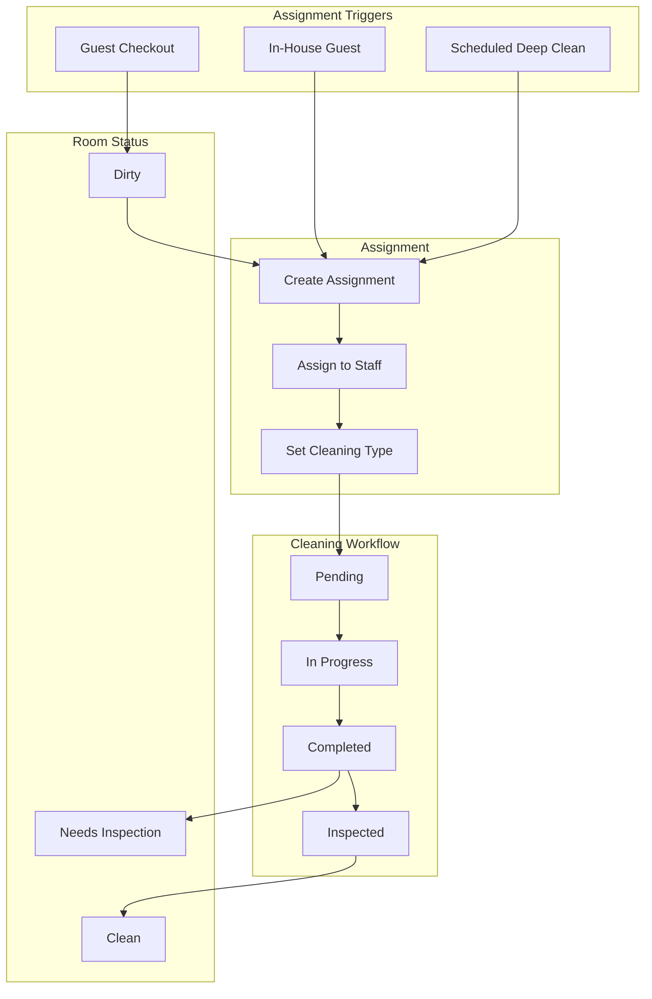
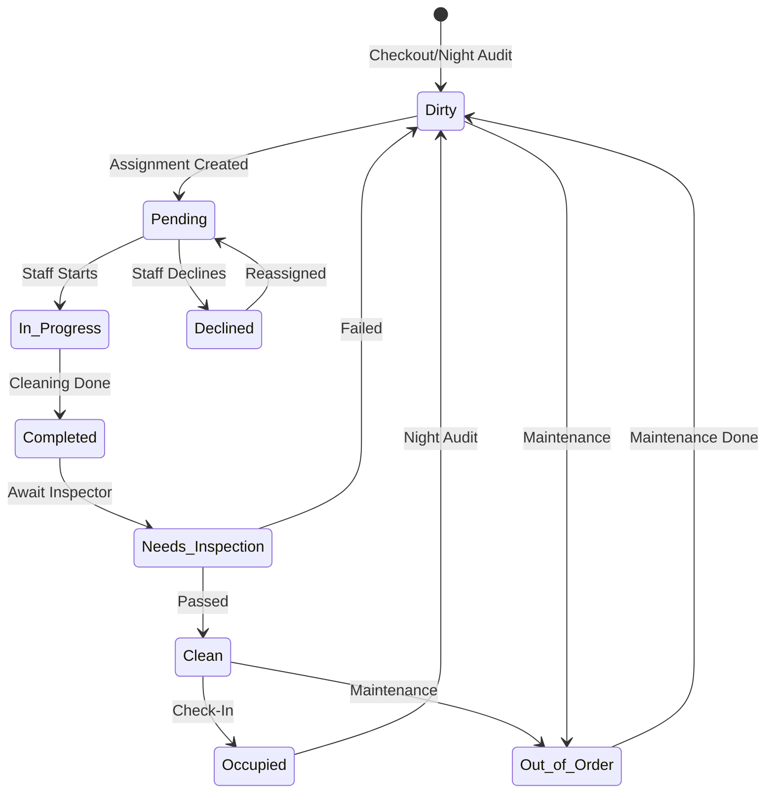
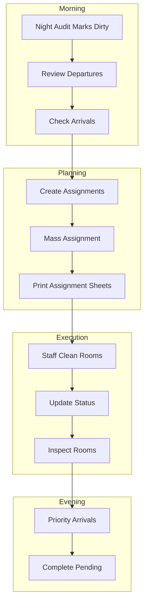
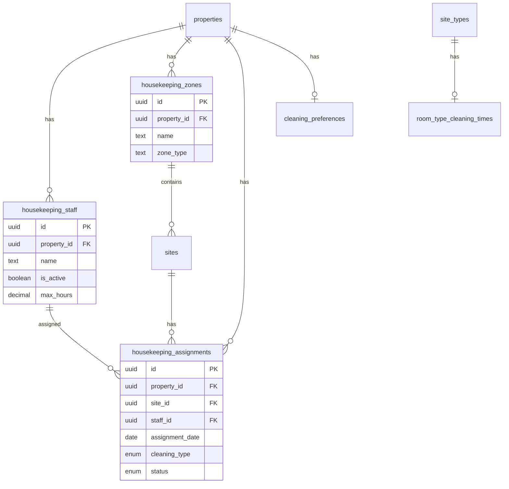

# Housekeeping Module

## Overview

The Housekeeping Module manages room cleaning operations including staff assignment, zone organization, cleaning workflow, and status tracking. It supports different cleaning types (stayover, departure, deep clean), configurable cleaning times per room type, and provides both desktop dashboard and mobile interfaces for housekeeping staff. The module integrates with the night audit process to automatically mark occupied rooms as dirty.

---

## Level 1: Capabilities

1. **Staff Management** - Manage housekeeping staff members and their availability
2. **Zone Organization** - Organize rooms into zones/floors for efficient assignment
3. **Assignment Management** - Create and track room cleaning assignments
4. **Cleaning Workflow** - Process rooms through the cleaning lifecycle
5. **Status Tracking** - Monitor real-time room cleanliness status
6. **Cleaning Time Configuration** - Set expected cleaning times per room type
7. **Mass Assignment** - Bulk assign rooms to staff members

---

## Level 2: Features

### 1. Staff Management
- **Staff Records**
  - Staff name
  - Active/inactive status
  - Maximum hours per day
  
- **Staff Availability**
  - Track working vs. non-working staff
  - Workload management
  - Hours tracking
  
- **Staff Performance**
  - Rooms cleaned per day
  - Average cleaning time
  - Assignment history

### 2. Zone Organization
- **Zone Definition**
  - Zone name
  - Zone type (floor, building, section)
  - Sort order for display
  
- **Room Assignment to Zones**
  - Assign rooms to zones
  - Rooms inherit zone for routing
  
- **Zone-Based Routing**
  - Assign entire zones to staff
  - Efficient geographical grouping

### 3. Assignment Management
- **Assignment Creation**
  - Assign specific room to staff
  - Set assignment date
  - Specify cleaning type
  - Add assignment notes
  
- **Cleaning Types**
  - Stayover - Light clean, guest staying
  - Departure - Full clean after checkout
  - Deep Clean - Intensive periodic cleaning
  
- **Assignment Distribution**
  - Manual assignment
  - Mass assignment dialog
  - Consider staff max hours
  - Balance workload

### 4. Cleaning Workflow
- **Status Progression**
  - Pending - Not yet started
  - In Progress - Currently cleaning
  - Completed - Cleaning finished
  - Inspected - Passed inspection
  - Declined - Staff declined assignment
  
- **Status Updates**
  - Mobile-friendly status changes
  - Timestamp tracking
  - Status history in JSONB
  
- **Inspection Flow**
  - Mark as needs inspection
  - Inspector approval
  - Return to dirty if failed

### 5. Status Tracking
- **Room Housekeeping Status**
  - Clean - Ready for guest
  - Dirty - Needs cleaning
  - Needs Inspection - Awaiting inspector
  - Out of Order - Not available
  
- **Real-Time Dashboard**
  - Visual status overview
  - Filter by status
  - Filter by zone
  - Filter by staff
  
- **Occupancy Integration**
  - Vacant vs. occupied indicators
  - Arrival/departure information

### 6. Cleaning Time Configuration
- **Per Room Type Settings**
  - Departure cleaning time (minutes)
  - Stayover cleaning time (minutes)
  
- **Time Estimation**
  - Calculate expected completion
  - Workload planning
  - Staffing requirements

### 7. Mass Assignment
- **Bulk Operations**
  - Select multiple rooms
  - Assign to single staff member
  - Set uniform cleaning type
  
- **Smart Assignment**
  - Consider zone grouping
  - Respect max hours
  - Balance distribution

---

## Database Tables

| Table | Purpose |
|-------|---------|
| `housekeeping_staff` | Staff member records |
| `housekeeping_zones` | Zone/floor definitions |
| `housekeeping_assignments` | Room cleaning assignments |
| `cleaning_preferences` | Property cleaning settings |
| `room_type_cleaning_times` | Cleaning time per room type |

### Table Details

#### housekeeping_staff
| Column | Type | Description |
|--------|------|-------------|
| `id` | uuid | Primary key |
| `property_id` | uuid | FK to properties |
| `name` | text | Staff name |
| `is_active` | boolean | Active status |
| `max_hours` | decimal | Max hours per day |
| `created_at` | timestamptz | Creation timestamp |
| `updated_at` | timestamptz | Last update |

#### housekeeping_zones
| Column | Type | Description |
|--------|------|-------------|
| `id` | uuid | Primary key |
| `property_id` | uuid | FK to properties |
| `name` | text | Zone name |
| `zone_type` | text | floor/building/section |
| `sort_order` | integer | Display order |
| `created_at` | timestamptz | Creation timestamp |
| `updated_at` | timestamptz | Last update |

#### housekeeping_assignments
| Column | Type | Description |
|--------|------|-------------|
| `id` | uuid | Primary key |
| `property_id` | uuid | FK to properties |
| `site_id` | uuid | FK to sites |
| `staff_id` | uuid | FK to housekeeping_staff |
| `assignment_date` | date | Assignment date |
| `cleaning_type` | enum | stayover/departure/deep_clean |
| `status` | enum | Assignment status |
| `notes` | text | Assignment notes |
| `status_history` | jsonb | Status change log |
| `assigned_by` | uuid | Assigned by user |
| `completed_at` | timestamptz | Completion time |
| `completed_by` | uuid | Completed by user |
| `inspected_at` | timestamptz | Inspection time |
| `inspected_by` | uuid | Inspected by user |

#### cleaning_preferences
| Column | Type | Description |
|--------|------|-------------|
| `id` | uuid | Primary key |
| `property_id` | uuid | FK to properties (unique) |
| `full_clean_interval` | integer | Days between deep cleans |
| `sheet_change_days` | integer | Days between sheet changes |
| `created_at` | timestamptz | Creation timestamp |
| `updated_at` | timestamptz | Last update |

#### room_type_cleaning_times
| Column | Type | Description |
|--------|------|-------------|
| `id` | uuid | Primary key |
| `site_type_id` | uuid | FK to site_types (unique) |
| `departure_minutes` | integer | Departure clean time |
| `stayover_minutes` | integer | Stayover clean time |
| `created_at` | timestamptz | Creation timestamp |
| `updated_at` | timestamptz | Last update |

---

## Dataflow

### Assignment Workflow

### Status Transition Flow

### Daily Housekeeping Flow

---

## Key Components

### Frontend Pages
- `Housekeeping.tsx` - Main housekeeping dashboard
- `HousekeepingMobile.tsx` - Mobile-optimized interface

### Frontend Components
- `HousekeepingDashboard.tsx` - Dashboard overview
- `HousekeepingSettings.tsx` - Configuration settings
- `HousekeepingStaff.tsx` - Staff management
- `HousekeepingZones.tsx` - Zone management
- `MassAssignmentDialog.tsx` - Bulk assignment dialog
- `PrintStaffAssignmentSheet.tsx` - Print staff assignments

### Database Functions
- `mark_occupied_rooms_dirty(p_property_id)` - Mark all occupied rooms dirty

---

## Enums

### housekeeping_status
| Value | Description |
|-------|-------------|
| `clean` | Room is clean and ready |
| `dirty` | Room needs cleaning |
| `needs_inspection` | Cleaned, awaiting inspection |
| `out_of_order` | Not available for use |

### cleaning_type
| Value | Description |
|-------|-------------|
| `stayover` | Light clean, guest staying |
| `departure` | Full clean after checkout |
| `deep_clean` | Intensive periodic cleaning |

### assignment_status
| Value | Description |
|-------|-------------|
| `pending` | Not yet started |
| `in_progress` | Currently being cleaned |
| `completed` | Cleaning finished |
| `inspected` | Passed inspection |
| `declined` | Staff declined assignment |

---

## Relationships

---

## Integration Points

1. **Site Module** - Room housekeeping status field
2. **Reservation Module** - Departure triggers cleaning need
3. **Night Audit** - Marks occupied rooms dirty
4. **Check-In** - Validates room is clean before assignment
5. **Reports** - Housekeeping productivity reporting

---

## Mobile Interface Features

The mobile interface (`HousekeepingMobile.tsx`) provides:

1. **Staff Login** - Simple staff identification
2. **Assignment List** - View assigned rooms
3. **Quick Status Update** - One-tap status changes
4. **Notes Entry** - Add cleaning notes
5. **Issue Reporting** - Report maintenance issues
6. **Offline Support** - Queue updates when offline (if implemented)
