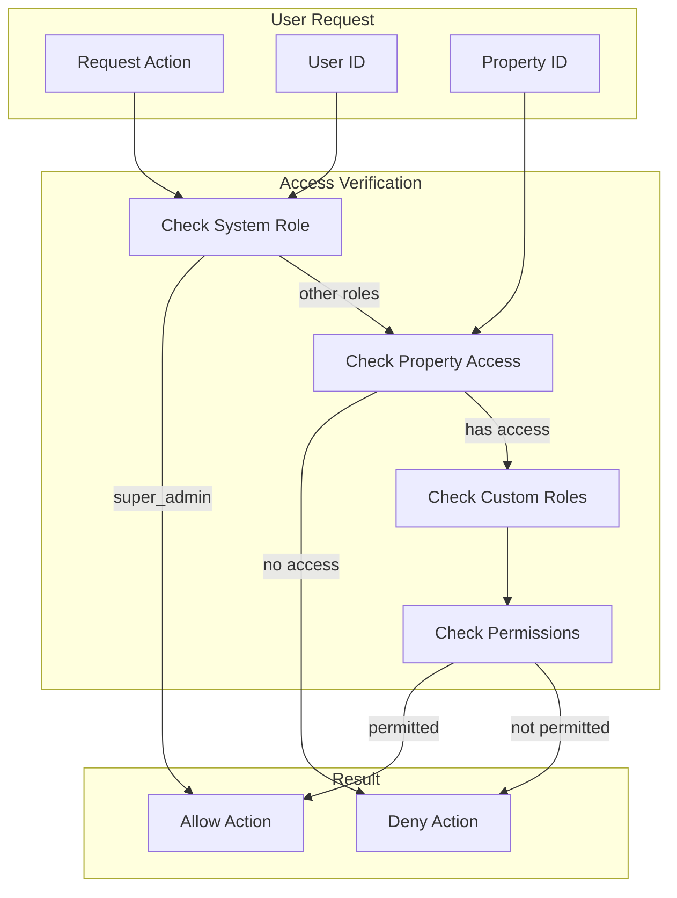
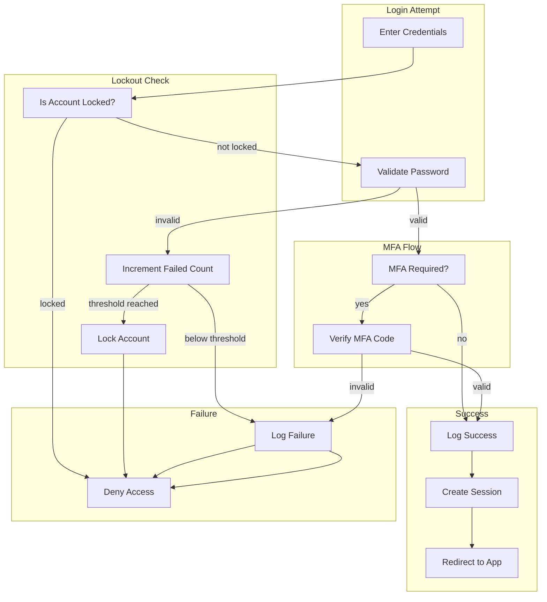
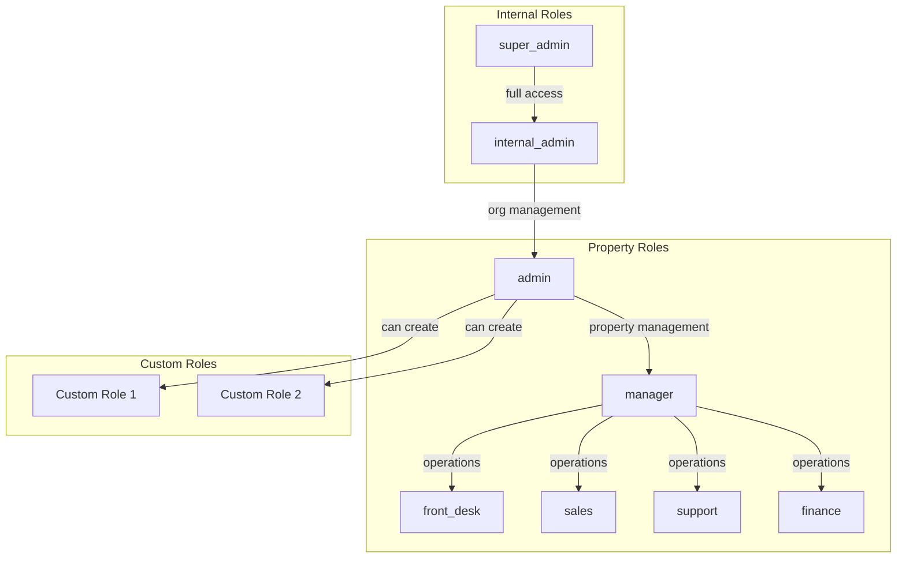
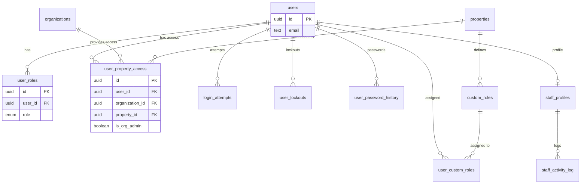

# User Management & Security Module

## Overview

The User Management & Security Module provides comprehensive access control, authentication, and security features for the PMS. It implements role-based access control (RBAC) with both system-wide roles and property-specific custom roles. The module handles user creation, property access management, MFA enforcement, password policies, login attempt tracking, and security audit logging.

---

## Level 1: Capabilities

1. **User Management** - Create and manage system users
2. **Role-Based Access Control** - Assign roles with defined permissions
3. **Property Access Control** - Manage user access to specific properties
4. **Custom Roles** - Define property-specific roles with granular permissions
5. **Authentication Security** - MFA, password policies, session management
6. **Login Security** - Track attempts, enforce lockouts
7. **Security Audit Logging** - Comprehensive security event tracking

---

## Level 2: Features

### 1. User Management
- **User Creation**
  - Email address (unique identifier)
  - Password with strength requirements
  - First name and last name
  - Role assignment
  - Property access assignment
  
- **User Types**
  - Property Users - Access specific properties
  - Organization Admins - Access all org properties
  - Internal Users - RoomMaster staff (super_admin)
  
- **User Operations**
  - Create new users
  - Edit user details
  - Reset passwords
  - Delete users
  - Suspend/reactivate accounts

### 2. Role-Based Access Control
- **System Roles**
  - `super_admin` - Full system access (internal)
  - `internal_admin` - Internal staff admin
  - `admin` - Property administrator
  - `manager` - Property manager
  - `front_desk` - Front desk staff
  - `sales` - Sales team
  - `support` - Support team
  - `finance` - Finance team
  
- **Role Assignment**
  - Global role per user
  - Determines base permissions
  - Stored in user_roles table

### 3. Property Access Control
- **Access Assignment**
  - Link user to specific properties
  - Link user to organization
  - Organization admin flag
  
- **Multi-Property Support**
  - Users can access multiple properties
  - Organization admins access all properties
  - Property switching in UI
  
- **Access Verification**
  - Database functions for access checks
  - Row-level security enforcement

### 4. Custom Roles
- **Role Definition**
  - Property-specific roles
  - Custom name and description
  - JSONB permissions object
  
- **Permission Categories**
  - Reservations (view, create, edit, cancel)
  - Guests (view, edit)
  - Rates (view, edit)
  - Accounting (view, post, close)
  - Housekeeping (view, assign, complete)
  - Reports (view, export)
  - Settings (view, edit)
  
- **Role Assignment**
  - Assign custom roles to users
  - Multiple custom roles per user
  - Supplements system role

### 5. Authentication Security
- **Multi-Factor Authentication (MFA)**
  - Property-level MFA requirement
  - TOTP-based verification
  - MFA enrollment flow
  - Skip MFA for trusted sessions
  
- **Password Policies**
  - Minimum length (default 12)
  - Require uppercase letters
  - Require numbers
  - Require special characters
  - Password rotation period
  - Password history (prevent reuse)
  
- **Session Management**
  - Session timeout configuration
  - Inactivity warning
  - Forced logout
  - Session tracking

### 6. Login Security
- **Attempt Tracking**
  - Log all login attempts
  - Success/failure tracking
  - IP address capture
  - User agent capture
  
- **Account Lockout**
  - Max failed attempts threshold
  - Lockout duration (minutes)
  - Automatic unlock after duration
  - Admin unlock capability
  - Lockout reason tracking
  
- **Lockout Management**
  - View locked accounts
  - Manual unlock
  - Lockout history

### 7. Security Audit Logging
- **Event Types**
  - Login success/failure
  - Password changes
  - Permission changes
  - User creation/deletion
  - Property access changes
  - Security setting changes
  
- **Event Details**
  - User involved
  - Property context
  - IP address
  - User agent
  - Timestamp
  - Additional metadata (JSONB)

---

## Database Tables

| Table | Purpose |
|-------|---------|
| `user_roles` | Global user role assignments |
| `user_property_access` | User access to specific properties |
| `custom_roles` | Property-specific role definitions |
| `user_custom_roles` | User-to-custom-role assignments |
| `login_attempts` | Login attempt tracking |
| `user_lockouts` | Account lockout records |
| `user_password_history` | Password change history |
| `security_audit_logs` | Security event logging |
| `staff_profiles` | Staff user profiles |
| `staff_activity_log` | Staff activity tracking |

### Table Details

#### user_roles
| Column | Type | Description |
|--------|------|-------------|
| `id` | uuid | Primary key |
| `user_id` | uuid | Supabase Auth user ID |
| `role` | enum | app_role assignment |
| `created_at` | timestamptz | Creation timestamp |

#### user_property_access
| Column | Type | Description |
|--------|------|-------------|
| `id` | uuid | Primary key |
| `user_id` | uuid | Supabase Auth user ID |
| `organization_id` | uuid | FK to organizations |
| `property_id` | uuid | FK to properties (optional) |
| `is_org_admin` | boolean | Organization admin flag |
| `created_at` | timestamptz | Creation timestamp |

#### custom_roles
| Column | Type | Description |
|--------|------|-------------|
| `id` | uuid | Primary key |
| `property_id` | uuid | FK to properties |
| `name` | text | Role name |
| `description` | text | Role description |
| `permissions` | jsonb | Permission flags |
| `created_at` | timestamptz | Creation timestamp |
| `updated_at` | timestamptz | Last update |

#### user_custom_roles
| Column | Type | Description |
|--------|------|-------------|
| `id` | uuid | Primary key |
| `user_id` | uuid | Supabase Auth user ID |
| `custom_role_id` | uuid | FK to custom_roles |
| `created_at` | timestamptz | Creation timestamp |

#### login_attempts
| Column | Type | Description |
|--------|------|-------------|
| `id` | uuid | Primary key |
| `user_id` | uuid | User ID |
| `property_id` | uuid | FK to properties |
| `success` | boolean | Login succeeded |
| `attempt_time` | timestamptz | Attempt timestamp |
| `ip_address` | text | Client IP |
| `user_agent` | text | Browser user agent |

#### user_lockouts
| Column | Type | Description |
|--------|------|-------------|
| `id` | uuid | Primary key |
| `user_id` | uuid | User ID |
| `locked_at` | timestamptz | Lock timestamp |
| `unlock_at` | timestamptz | Scheduled unlock |
| `unlocked_at` | timestamptz | Actual unlock time |
| `unlocked_by` | uuid | Unlocked by user |
| `reason` | text | Lockout reason |

#### user_password_history
| Column | Type | Description |
|--------|------|-------------|
| `id` | uuid | Primary key |
| `user_id` | uuid | User ID |
| `password_changed_at` | timestamptz | Change timestamp |
| `changed_by` | uuid | Changed by user |

#### security_audit_logs
| Column | Type | Description |
|--------|------|-------------|
| `id` | uuid | Primary key |
| `user_id` | uuid | User ID |
| `property_id` | uuid | FK to properties |
| `event_type` | text | Event type |
| `event_description` | text | Description |
| `ip_address` | text | Client IP |
| `user_agent` | text | Browser user agent |
| `metadata` | jsonb | Additional data |
| `created_at` | timestamptz | Event timestamp |

#### staff_profiles
| Column | Type | Description |
|--------|------|-------------|
| `id` | uuid | Primary key |
| `user_id` | uuid | Supabase Auth user ID |
| `first_name` | text | First name |
| `last_name` | text | Last name |
| `created_at` | timestamptz | Creation timestamp |
| `updated_at` | timestamptz | Last update |

#### staff_activity_log
| Column | Type | Description |
|--------|------|-------------|
| `id` | uuid | Primary key |
| `staff_id` | uuid | FK to staff_profiles |
| `action` | text | Action performed |
| `details` | jsonb | Action details |
| `created_at` | timestamptz | Action timestamp |

---

## Dataflow

### User Access Verification Flow

### Login Flow with Security

### Role Hierarchy

---

## Key Components

### Frontend Pages
- `UserManagement.tsx` - User management page
- `Login.tsx` - Login page with security features
- `ChangePassword.tsx` - Password change page
- `SuspendedAccount.tsx` - Suspended account notice

### Admin Pages
- `AdminUserAccess.tsx` - Manage user access (super admin)
- `AdminUsers.tsx` - Manage internal users (super admin)

### Frontend Components
- `ProtectedRoute.tsx` - Route protection wrapper
- `MFAEnrollment.tsx` - MFA setup component
- `MFAVerification.tsx` - MFA code entry
- `PasswordStrengthIndicator.tsx` - Password strength display
- `SecuritySettingsCard.tsx` - Security settings
- `PermissionGrid.tsx` - Permission display grid
- `PropertyAccessManager.tsx` - Manage property access
- `CustomRoleManager.tsx` - Custom role management

### User Management Components
- `CreateUserDialog.tsx` - Create new user
- `EditUserDialog.tsx` - Edit user details
- `DeleteUserDialog.tsx` - Delete user confirmation
- `RemoveAccessDialog.tsx` - Remove property access
- `RoleChangeDialog.tsx` - Change user role
- `RolePermissionsCard.tsx` - Role permissions display
- `StaffRolesCard.tsx` - Staff role management

### Edge Functions
- `create-user` - Create users via Supabase Admin API
  - Actions: create, reset-password, delete-user

### Hooks
- `useInternalUser.ts` - Check internal user status
- `useSuperAdmin.ts` - Check super admin status
- `useOrgAdmin.ts` - Check org admin status
- `useUserManagement.ts` - User management operations
- `useUserManagementDialogs.ts` - Dialog state management
- `useInactivityTimeout.ts` - Session timeout handling

### Database Functions
- `has_role(_role, _user_id)` - Check if user has role
- `is_super_admin()` - Check super admin status
- `is_org_admin(_organization_id)` - Check org admin status
- `user_can_access_property(_property_id)` - Check property access
- `user_has_property_access(_property_id)` - Verify property access

---

## Enums

### app_role
| Value | Description |
|-------|-------------|
| `super_admin` | Full system access (internal) |
| `internal_admin` | Internal staff admin |
| `admin` | Property administrator |
| `manager` | Property manager |
| `front_desk` | Front desk staff |
| `sales` | Sales team |
| `support` | Support team |
| `finance` | Finance team |

---

## Relationships

---

## Security Best Practices

1. **Password Security**
   - Minimum 12 characters
   - Complexity requirements enforced
   - Password history prevents reuse
   - Rotation enforced (configurable)

2. **Session Security**
   - Inactivity timeout (default 15 min)
   - Warning before timeout
   - Secure session tokens via Supabase

3. **Access Control**
   - Principle of least privilege
   - Property-level isolation
   - Row-level security in database

4. **Audit Trail**
   - All security events logged
   - IP and user agent tracking
   - Immutable audit records
