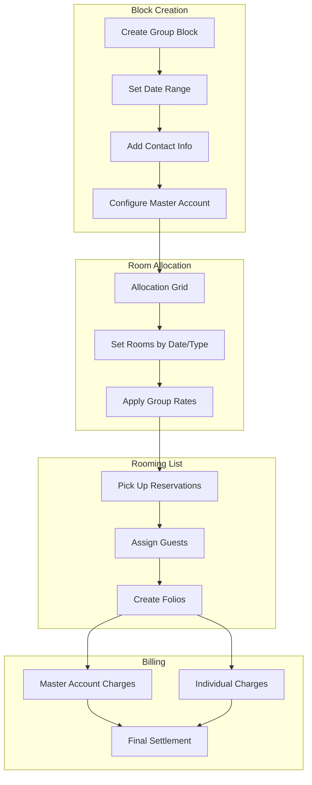
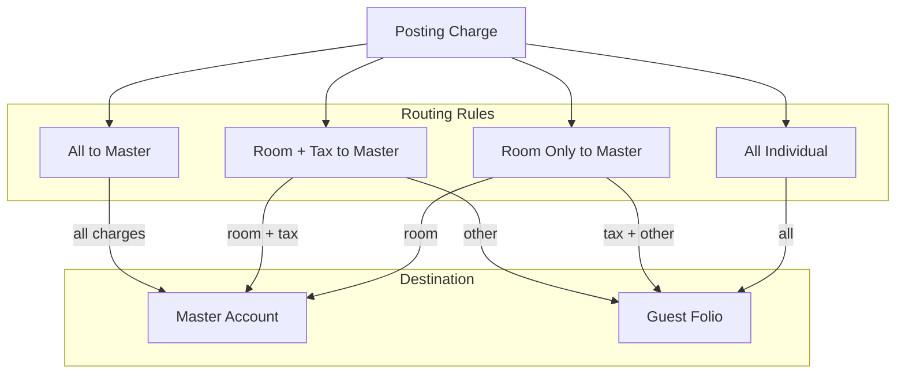
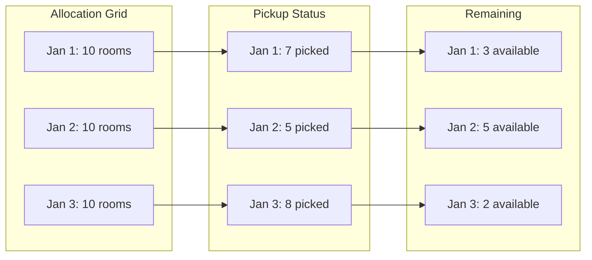
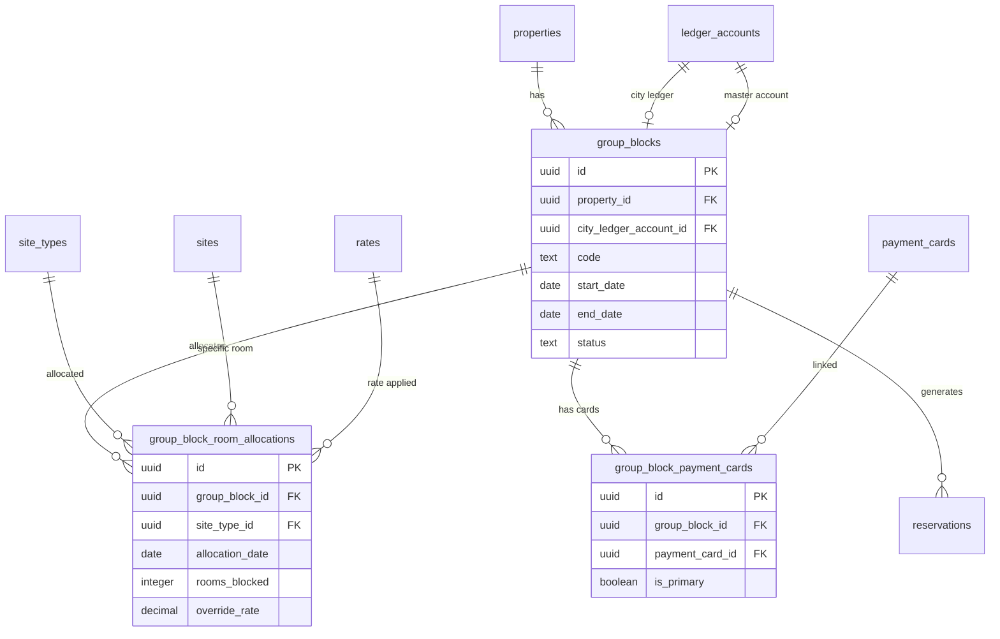

# Group Blocks Module

## Overview

The Group Blocks Module manages group reservations where multiple rooms are blocked for events, corporate bookings, weddings, or tour groups. It supports room allocation by date and room type, negotiated group rates, master billing accounts, and rooming list management. The module integrates with city ledger for direct billing and provides comprehensive group block analytics.

---

## Level 1: Capabilities

1. **Group Block Creation** - Define group blocks with date ranges and contact information
2. **Room Allocation** - Block rooms by type and date with negotiated rates
3. **Master Account Management** - Centralized billing for group charges
4. **Rooming List** - Pick up individual reservations from the block
5. **Group Payment Cards** - Store payment cards for group billing
6. **Group Analytics** - Track pickup rates and revenue

---

## Level 2: Features

### 1. Group Block Creation
- **Block Identification**
  - Unique block code
  - Descriptive name
  - Date range (start/end)
  - Status tracking (active, tentative, cancelled)
  
- **Contact Information**
  - Contact first and last name
  - Contact email
  - Contact phone
  - Mailing address (street, city, state, zip, country)
  
- **Block Settings**
  - Allow other room types (beyond allocated)
  - Allow overbooking
  - Charge routing configuration

### 2. Room Allocation
- **Allocation by Date**
  - Per-date room blocking
  - Room type selection
  - Number of rooms per date
  
- **Specific Room Allocation**
  - Optionally block specific rooms
  - Room type-only allocation supported
  
- **Rate Configuration**
  - Link to rate plan
  - Override rate per allocation
  - Negotiated group pricing
  
- **Allocation Grid**
  - Visual date-by-room-type grid
  - Easy allocation adjustment
  - Real-time pickup tracking

### 3. Master Account Management
- **Master Account Setup**
  - Enable/disable master billing
  - Master contact information
  - Separate from group contact
  
- **City Ledger Integration**
  - Link to city ledger account
  - Direct billing to company
  - Credit limit enforcement
  
- **Charge Routing**
  - All charges to master
  - Room & tax to master
  - Room only to master
  - Individual billing

### 4. Rooming List
- **Reservation Pickup**
  - Create reservations from block
  - Auto-apply group rate
  - Link to group block
  
- **Guest Assignment**
  - Assign guests to picked-up rooms
  - Individual confirmation numbers
  - Share group contact data
  
- **Pickup Tracking**
  - Rooms picked up vs. allocated
  - Pickup percentage
  - Remaining availability

### 5. Group Payment Cards
- **Card Storage**
  - Store cards for group payments
  - Primary card designation
  - Multiple cards per group
  
- **Card Linking**
  - Link to payment_cards table
  - Apply to master account
  - Authorization creation

### 6. Group Analytics
- **Pickup Metrics**
  - Total rooms allocated
  - Total rooms picked up
  - Pickup percentage by date
  - Pickup percentage by room type
  
- **Revenue Tracking**
  - Projected revenue
  - Actual revenue
  - Revenue charts
  
- **Block Performance**
  - Block status overview
  - Cutoff date management
  - Wash factor tracking

---

## Database Tables

| Table | Purpose |
|-------|---------|
| `group_blocks` | Group block header records |
| `group_block_room_allocations` | Per-date room allocations |
| `group_block_payment_cards` | Payment cards for group billing |

### Table Details

#### group_blocks
| Column | Type | Description |
|--------|------|-------------|
| `id` | uuid | Primary key |
| `property_id` | uuid | FK to properties |
| `city_ledger_account_id` | uuid | FK to ledger_accounts (AR) |
| `master_ledger_account_id` | uuid | FK to ledger_accounts (master folio) |
| `code` | text | Unique block code |
| `description` | text | Block description |
| `start_date` | date | Block start date |
| `end_date` | date | Block end date |
| `status` | text | active/tentative/cancelled |
| `contact_first_name` | text | Contact first name |
| `contact_last_name` | text | Contact last name |
| `contact_email` | text | Contact email |
| `contact_phone` | text | Contact phone |
| `street_address` | text | Street address |
| `city` | text | City |
| `state` | text | State |
| `zipcode` | text | Postal code |
| `country` | text | Country |
| `has_master_account` | boolean | Enable master billing |
| `allow_other_room_types` | boolean | Allow non-blocked types |
| `allow_overbooking` | boolean | Allow over pickup |
| `charge_routing` | text | Routing rule |
| `master_contact_name` | text | Master billing contact |
| `master_contact_email` | text | Master billing email |
| `master_contact_phone` | text | Master billing phone |
| `created_at` | timestamptz | Creation timestamp |
| `updated_at` | timestamptz | Last update |

#### group_block_room_allocations
| Column | Type | Description |
|--------|------|-------------|
| `id` | uuid | Primary key |
| `group_block_id` | uuid | FK to group_blocks |
| `site_type_id` | uuid | FK to site_types |
| `site_id` | uuid | FK to sites (specific room) |
| `rate_id` | uuid | FK to rates |
| `allocation_date` | date | Date of allocation |
| `rooms_blocked` | integer | Number of rooms |
| `override_rate` | decimal | Override rate |
| `created_at` | timestamptz | Creation timestamp |

#### group_block_payment_cards
| Column | Type | Description |
|--------|------|-------------|
| `id` | uuid | Primary key |
| `group_block_id` | uuid | FK to group_blocks |
| `payment_card_id` | uuid | FK to payment_cards |
| `is_primary` | boolean | Primary card |
| `created_at` | timestamptz | Creation timestamp |

---

## Dataflow

### Group Block Lifecycle

### Charge Routing Flow

### Allocation and Pickup

---

## Key Components

### Frontend Pages
- `GroupBlocks.tsx` - Group block list and management
- `GroupBlockDetail.tsx` - Individual group block detail/edit

### Frontend Components
- `GroupBlockAllocationGrid.tsx` - Room allocation grid
- `GroupBlockAvailabilityGrid.tsx` - Availability display
- `GroupBlockPaymentCards.tsx` - Payment card management
- `GroupBlockRevenueChart.tsx` - Revenue visualization
- `GroupMasterDeposit.tsx` - Master account deposit handling

---

## Relationships

---

## Integration Points

1. **Reservation Module** - Reservations linked to group blocks
2. **Rate Module** - Group rates and overrides
3. **Accounting Module** - Master account and city ledger
4. **Payment Module** - Group payment cards
5. **Site Module** - Room availability and allocation
6. **Reports Module** - Group block analytics

---

## Charge Routing Options

| Option | Room Charges | Tax | Other Charges |
|--------|--------------|-----|---------------|
| All to Master | Master | Master | Master |
| Room + Tax to Master | Master | Master | Guest |
| Room Only to Master | Master | Guest | Guest |
| Individual | Guest | Guest | Guest |

---

## Status Values

| Status | Description |
|--------|-------------|
| `active` | Block is confirmed and active |
| `tentative` | Pending confirmation |
| `cancelled` | Block has been cancelled |
| `definite` | Block is contracted |
| `actualized` | Event has occurred |
