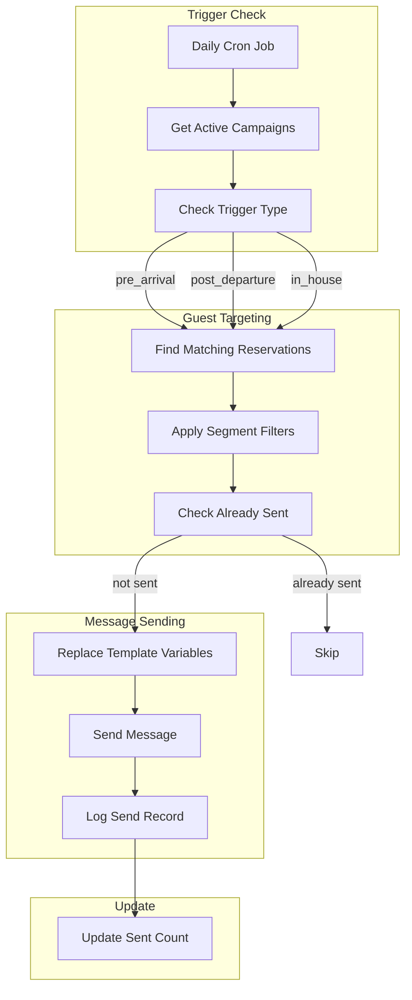
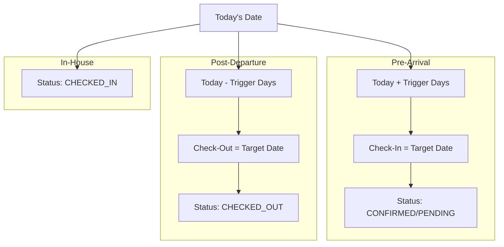
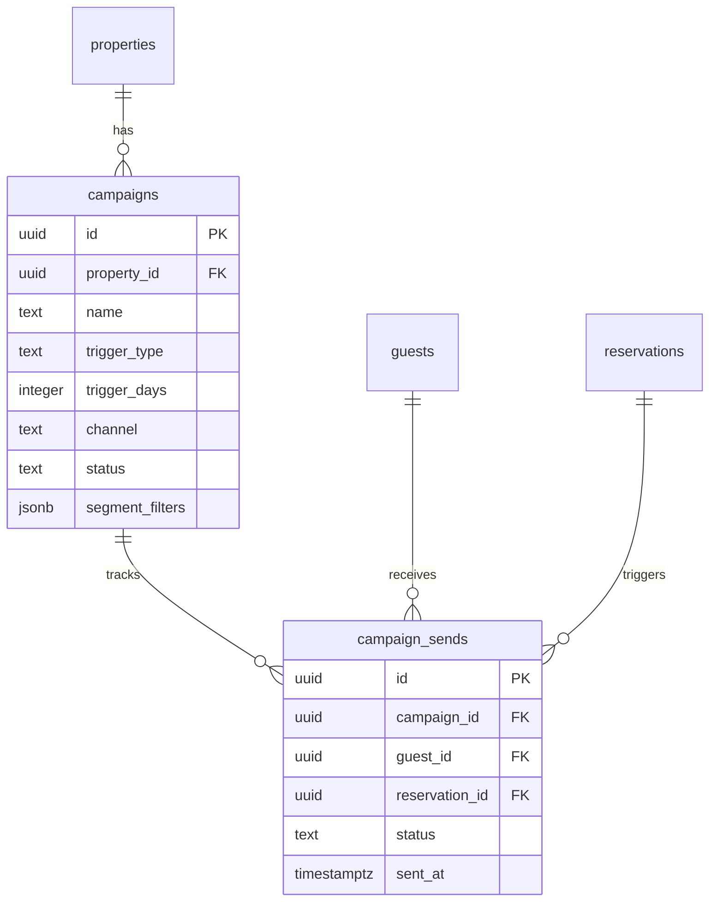

# CRM & Marketing Module

## Overview

The CRM & Marketing Module enables targeted guest communication through automated and manual campaigns. It supports multiple channels (email, SMS), various trigger types (pre-arrival, post-departure, in-house), and guest segmentation based on profile attributes. The module tracks campaign performance and prevents duplicate sends to the same guest for the same campaign.

---

## Level 1: Capabilities

1. **Campaign Management** - Create and manage marketing campaigns
2. **Automated Triggers** - Schedule campaigns based on reservation events
3. **Guest Segmentation** - Target specific guest segments with filters
4. **Template System** - Create reusable message templates with variables
5. **Send Tracking** - Monitor campaign delivery and performance
6. **Multi-Channel Delivery** - Support email and SMS channels

---

## Level 2: Features

### 1. Campaign Management
- **Campaign Definition**
  - Campaign name
  - Status (draft, active, paused, completed)
  - Channel selection (email, SMS)
  - Property association
  
- **Campaign Lifecycle**
  - Draft - Under construction
  - Active - Running and sending
  - Paused - Temporarily stopped
  - Completed - Finished running

### 2. Automated Triggers
- **Trigger Types**
  - Pre-Arrival - X days before check-in
  - Post-Departure - X days after check-out
  - In-House - Send to currently checked-in guests
  - Manual - Send on demand
  
- **Trigger Configuration**
  - Trigger type selection
  - Days offset (for pre/post triggers)
  - Automatic daily processing

### 3. Guest Segmentation
- **Filter Criteria**
  - City - Guest's home city
  - State - Guest's home state
  - Source of Business - Booking source
  - Birthday Month - Birthday-based targeting
  - Anniversary Month - Anniversary targeting
  
- **Filter Application**
  - Combine multiple filters
  - Exclude criteria support
  - Real-time segment preview

### 4. Template System
- **Email Templates**
  - Subject line
  - HTML content body
  - Rich text editor support
  
- **SMS Templates**
  - Short message content
  - Character limit awareness
  
- **Template Variables**
  - `{{first_name}}` - Guest first name
  - `{{last_name}}` - Guest last name
  - `{{check_in_date}}` - Arrival date
  - `{{check_out_date}}` - Departure date
  
- **Variable Replacement**
  - Automatic substitution at send time
  - Fallback values for missing data

### 5. Send Tracking
- **Delivery Records**
  - Campaign ID
  - Guest ID
  - Reservation ID
  - Send timestamp
  - Delivery status
  
- **Duplicate Prevention**
  - Check existing sends before sending
  - One send per campaign per reservation
  
- **Campaign Metrics**
  - Total sent count
  - Per-campaign statistics

### 6. Multi-Channel Delivery
- **Email Channel**
  - Subject and body
  - HTML formatting
  - Mock mode for testing
  
- **SMS Channel**
  - Short message format
  - Phone number validation
  - Mock mode for testing

---

## Database Tables

| Table | Purpose |
|-------|---------|
| `campaigns` | Campaign definitions |
| `campaign_sends` | Send tracking records |

### Table Details

#### campaigns
| Column | Type | Description |
|--------|------|-------------|
| `id` | uuid | Primary key |
| `property_id` | uuid | FK to properties |
| `name` | text | Campaign name |
| `trigger_type` | text | manual/pre_arrival/post_departure/in_house |
| `trigger_days` | integer | Days offset for triggers |
| `channel` | text | email/sms |
| `subject` | text | Email subject line |
| `content` | text | Message content/body |
| `segment_filters` | jsonb | Guest segment filters |
| `status` | text | draft/active/paused/completed |
| `sent_count` | integer | Total times sent |
| `created_at` | timestamptz | Creation timestamp |
| `updated_at` | timestamptz | Last update |

#### campaign_sends
| Column | Type | Description |
|--------|------|-------------|
| `id` | uuid | Primary key |
| `campaign_id` | uuid | FK to campaigns |
| `guest_id` | uuid | FK to guests |
| `reservation_id` | uuid | FK to reservations |
| `status` | text | sent/failed/bounced |
| `sent_at` | timestamptz | Send timestamp |

---

## Dataflow

### Campaign Processing Flow



### Trigger Type Logic



### Segment Filter Application

```mermaid
flowchart LR
    subgraph reservations [All Matching Reservations]
        RES[100 Reservations]
    end
    
    subgraph filters [Filter Application]
        CITY[City Filter: "Miami"]
        STATE[State Filter: "FL"]
        SOURCE[Source: "Direct"]
    end
    
    subgraph result [Filtered Result]
        FINAL[15 Reservations]
    end
    
    RES -->|filter by city| CITY
    CITY -->|filter by state| STATE
    STATE -->|filter by source| SOURCE
    SOURCE --> FINAL
```

---

## Key Components

### Frontend Pages
- `CRM.tsx` - Campaign list and management
- `CampaignEditor.tsx` - Create/edit campaigns

### Frontend Components
- `CampaignPreview.tsx` - Preview campaign before sending
- `CampaignSegmentFilter.tsx` - Segment filter builder
- `RichTextEditor.tsx` - Rich text content editor

### Edge Functions
- `process-campaigns` - Automated campaign processing
  - Called by scheduled cron job
  - Processes all active automated campaigns
  - Applies filters and sends messages
  - Records all sends

---

## Segment Filter Schema

```json
{
  "city": "Miami",
  "state": "FL",
  "source_of_business_id": "uuid-here",
  "birthday_month": 12,
  "anniversary_month": 6
}
```

All filters are optional. Multiple filters are combined with AND logic.

---

## Template Variable Examples

### Pre-Arrival Email

```
Subject: Your Stay at {{property_name}} is Coming Up!

Hi {{first_name}},

We're excited to welcome you on {{check_in_date}}!

Here's what you need to know before your arrival...

See you soon!
```

### Post-Departure Email

```
Subject: Thank You for Staying with Us!

Dear {{first_name}} {{last_name}},

Thank you for choosing us for your recent stay 
from {{check_in_date}} to {{check_out_date}}.

We hope you had a wonderful experience...
```

---

## Relationships



---

## Integration Points

1. **Guest Module** - Guest profiles for targeting and personalization
2. **Reservation Module** - Reservation data for trigger matching
3. **Source of Business** - Filter by booking source
4. **Property Module** - Property-specific campaigns

---

## Trigger Processing Schedule

The `process-campaigns` edge function should be called on a schedule (e.g., daily at 6 AM property time) to process automated campaigns:

1. Fetches all active, non-manual campaigns
2. For each campaign:
   - Calculates target date based on trigger type and days
   - Finds matching reservations
   - Applies segment filters
   - Excludes already-sent recipients
   - Sends messages and logs sends
3. Updates campaign sent counts

---

## Mock Mode

In development/testing, the system operates in mock mode:
- Messages are logged but not actually sent
- Console output shows what would be sent
- Send records are still created
- Enables safe testing without real delivery

---

## Status Values

### Campaign Status
| Status | Description |
|--------|-------------|
| `draft` | Being created, not active |
| `active` | Running and processing |
| `paused` | Temporarily stopped |
| `completed` | Finished campaign |

### Send Status
| Status | Description |
|--------|-------------|
| `sent` | Successfully sent |
| `failed` | Send failed |
| `bounced` | Email bounced back |
