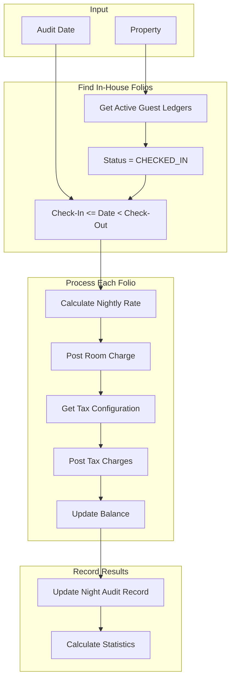
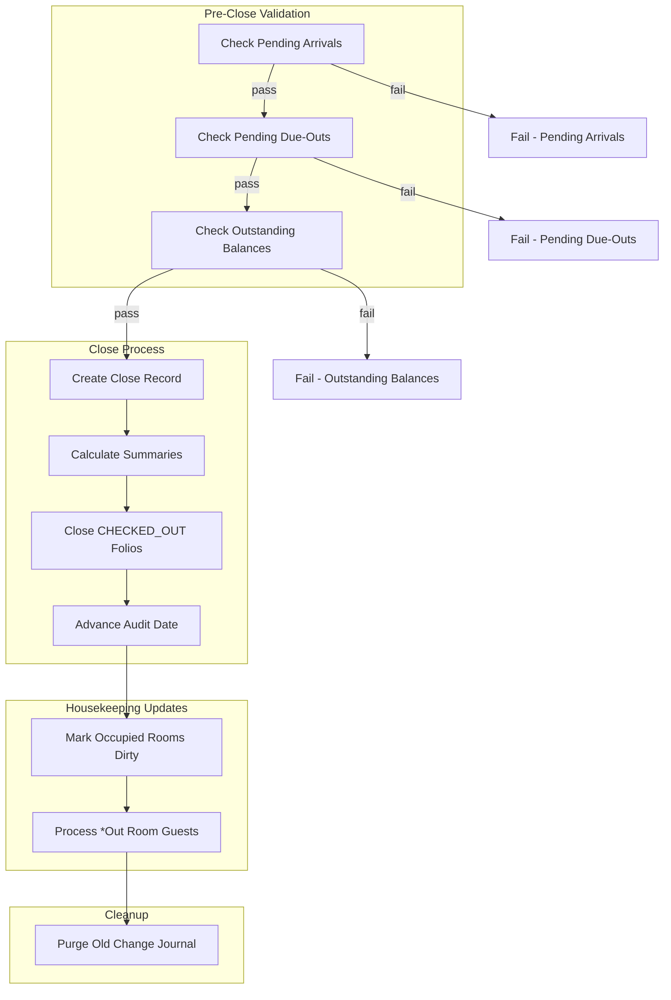
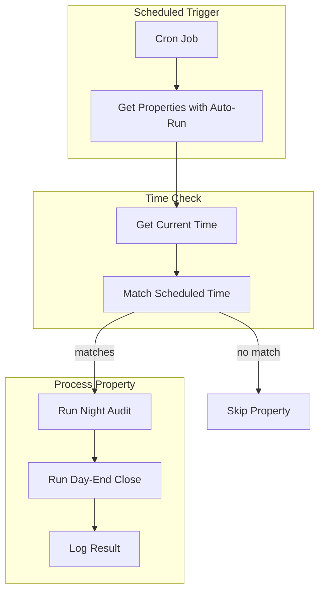
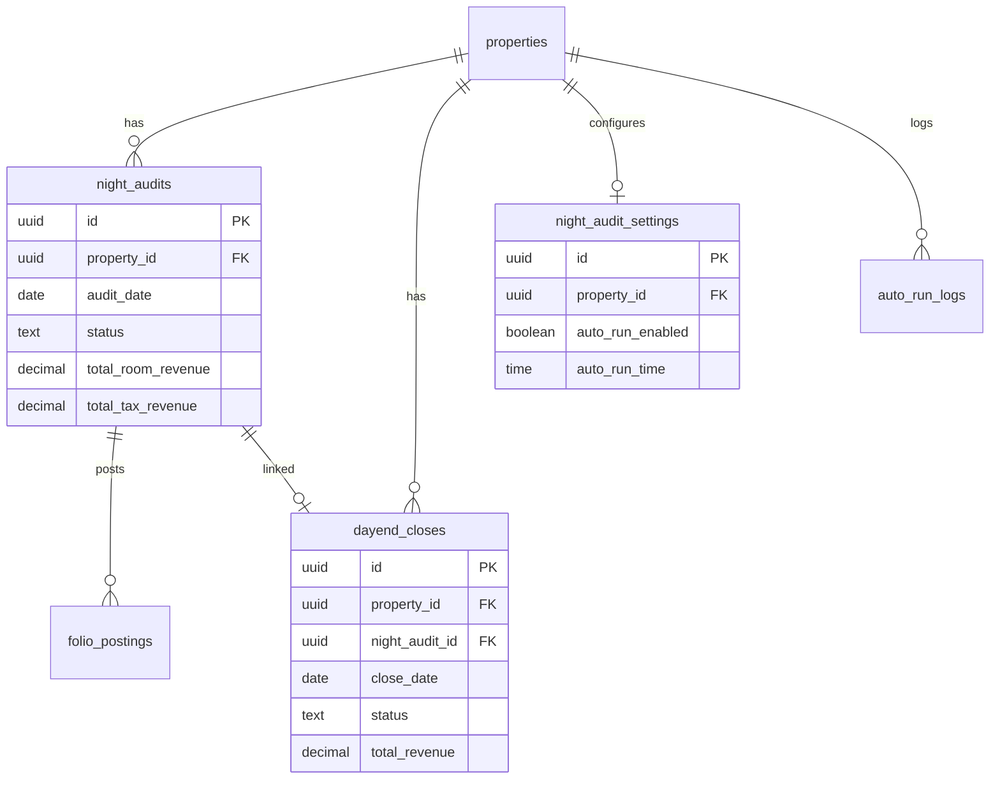

# Night Audit & Day-End Module

## Overview

The Night Audit & Day-End Module handles the critical end-of-day processing for hospitality operations. It posts room charges and taxes to in-house guest folios, validates operational readiness, closes the business day, advances the audit date, and performs housekeeping status updates. The module supports both manual execution and automated scheduling via edge functions.

---

## Level 1: Capabilities

1. **Night Audit Processing** - Post room and tax charges to in-house guest folios
2. **Pre-Close Validation** - Validate that day can be closed (no pending arrivals/departures)
3. **Day-End Close** - Close the business day and advance audit date
4. **Automated Scheduling** - Schedule automatic night audit and day-end close
5. **Audit Logging** - Track night audit and day-end results
6. **Housekeeping Integration** - Update room statuses during day-end

---

## Level 2: Features

### 1. Night Audit Processing
- **Room Charge Posting**
  - Calculate nightly rate per reservation
  - Post room charge to each in-house folio
  - Link to revenue account from rate
  - Record posting in folio_postings
  
- **Tax Posting**
  - Calculate taxes based on revenue account configuration
  - Support percentage, per-night, and per-person taxes
  - Post each tax separately
  - Handle tax-on-tax scenarios
  
- **In-House Identification**
  - Only process CHECKED_IN reservations
  - Validate stay dates include audit date
  - Skip already-processed folios
  
- **Running Balance**
  - Update running balance after each posting
  - Update ledger_account balance
  - Create ledger_transactions

### 2. Pre-Close Validation
- **Pending Arrivals Check**
  - Identify CONFIRMED reservations for audit date
  - Must be checked in or cancelled before close
  - Fail validation if arrivals pending
  
- **Due-Out Check**
  - Identify CHECKED_IN guests with checkout = audit date
  - Must be checked out before close
  - Fail validation if due-outs pending
  
- **Outstanding Balances**
  - Check CHECKED_OUT guests with folio balance
  - Must have zero balance or transfer to city ledger
  - Fail validation if balances remain

### 3. Day-End Close
- **Close Record Creation**
  - Create dayend_closes record
  - Link to night_audit record
  - Set status to "closed"
  - Record closing user and timestamp
  
- **Summary Calculation**
  - Total revenue for the day
  - Total taxes for the day
  - Total payments for the day
  - Total refunds for the day
  - Opening/closing AR balances
  - Ledger summary by type
  
- **Audit Date Advancement**
  - Advance property audit_date to next day
  - New business date active
  
- **CHECKED_OUT Folio Closure**
  - Close folios for checked-out guests
  - Set is_active = false
  - Set closed_at timestamp

### 4. Automated Scheduling
- **Auto-Run Configuration**
  - Enable/disable auto-run per property
  - Set scheduled time (e.g., 02:00)
  - Timezone awareness
  
- **Scheduled Execution**
  - Edge function called by cron
  - Check if current time matches schedule
  - Run night audit + day-end close
  
- **Error Handling**
  - Skip properties with failures
  - Log results per property
  - Continue to next property on error

### 5. Audit Logging
- **Night Audit Record**
  - Audit date
  - Status (pending, in_progress, completed, failed)
  - Folios processed count
  - Room revenue total
  - Tax revenue total
  - Other revenue total
  - Payment total
  - Start/complete timestamps
  - Started/completed by user
  
- **Auto-Run Logs**
  - Property ID
  - Run type (full_cycle)
  - Status (success, failed, skipped, error)
  - Message details
  - Audit date
  - Processing statistics

### 6. Housekeeping Integration
- **Occupied Room Status**
  - Mark all occupied rooms as dirty
  - Triggered during day-end close
  - Ready for morning cleaning
  
- **Out Room Processing**
  - Process *Out room guests
  - Close folios with zero balance
  - Move to history

### 7. Data Cleanup
- **Change Journal Purge**
  - Delete entries older than 45 days
  - Run during day-end close
  - Property-specific cleanup

---

## Database Tables

| Table | Purpose |
|-------|---------|
| `night_audits` | Night audit processing records |
| `night_audit_settings` | Auto-run configuration |
| `dayend_closes` | Day-end close records |
| `auto_run_logs` | Automated processing logs |

### Table Details

#### night_audits
| Column | Type | Description |
|--------|------|-------------|
| `id` | uuid | Primary key |
| `property_id` | uuid | FK to properties |
| `audit_date` | date | Audit date |
| `status` | text | pending/in_progress/completed/failed |
| `folios_processed` | integer | Number of folios processed |
| `total_room_revenue` | decimal | Total room charges |
| `total_tax_revenue` | decimal | Total tax charges |
| `total_other_revenue` | decimal | Other revenue |
| `total_payments` | decimal | Payment total |
| `notes` | text | Notes |
| `started_at` | timestamptz | Start timestamp |
| `started_by` | uuid | Started by user |
| `completed_at` | timestamptz | Completion timestamp |
| `completed_by` | uuid | Completed by user |

#### night_audit_settings
| Column | Type | Description |
|--------|------|-------------|
| `id` | uuid | Primary key |
| `property_id` | uuid | FK to properties (unique) |
| `auto_run_enabled` | boolean | Enable auto-run |
| `auto_run_time` | time | Scheduled time |

#### dayend_closes
| Column | Type | Description |
|--------|------|-------------|
| `id` | uuid | Primary key |
| `property_id` | uuid | FK to properties |
| `night_audit_id` | uuid | FK to night_audits |
| `close_date` | date | Close date |
| `status` | text | open/closed |
| `total_revenue` | decimal | Total revenue |
| `total_taxes` | decimal | Total taxes |
| `total_payments` | decimal | Total payments |
| `total_refunds` | decimal | Total refunds |
| `opening_ar_balance` | decimal | Opening AR |
| `closing_ar_balance` | decimal | Closing AR |
| `account_summary` | jsonb | Account summary |
| `ledger_summary` | jsonb | Ledger summary |
| `closed_at` | timestamptz | Close timestamp |
| `closed_by` | uuid | Closed by user |
| `closed_by_name` | text | Closed by name |

#### auto_run_logs
| Column | Type | Description |
|--------|------|-------------|
| `id` | uuid | Primary key |
| `property_id` | uuid | FK to properties |
| `run_type` | text | full_cycle/night_audit/dayend |
| `status` | text | success/failed/skipped/error |
| `audit_date` | date | Audit date processed |
| `folios_processed` | integer | Folios processed |
| `total_room_revenue` | decimal | Room revenue |
| `total_tax_revenue` | decimal | Tax revenue |
| `message` | text | Status message |
| `created_at` | timestamptz | Run timestamp |

---

## Dataflow

### Night Audit Processing Flow



### Day-End Close Flow



### Automated Run Flow



---

## Key Components

### Frontend Pages
- `DayendClose.tsx` - Night audit and day-end close page

### Edge Functions
- `auto-dayend-close` - Automated night audit and day-end close
  - Called by scheduled cron job
  - Processes all properties with auto-run enabled
  - Performs full night audit and day-end close cycle
  - Logs all results to auto_run_logs

### Context
- `AuditDateContext.tsx` - Provides current audit date to components

### Database Functions
- `mark_occupied_rooms_dirty(p_property_id)` - Mark occupied rooms dirty

---

## Night Audit Calculation

### Room Charge Calculation

```
Total Price / Number of Nights = Nightly Rate

Example:
- Total Price: $750
- Check-In: Jan 1, Check-Out: Jan 6 (5 nights)
- Nightly Rate: $750 / 5 = $150
```

### Tax Calculation

```
Revenue: $150

Tax Configuration:
1. State Tax: 8% = $150 × 0.08 = $12.00
2. City Tax: 3% = $150 × 0.03 = $4.50
3. Tourism Fee: $2/night = $2.00

Total with Tax: $150 + $12 + $4.50 + $2 = $168.50
```

---

## Relationships



---

## Integration Points

1. **Accounting Module** - Folio posting and ledger updates
2. **Reservation Module** - Identify in-house guests
3. **Housekeeping Module** - Mark rooms dirty
4. **Property Module** - Audit date management
5. **Rate Module** - Revenue account for postings
6. **Payment Module** - Payment totals

---

## Status Values

### Night Audit Status
| Status | Description |
|--------|-------------|
| `pending` | Not yet started |
| `in_progress` | Currently running |
| `completed` | Successfully finished |
| `failed` | Failed with errors |

### Day-End Close Status
| Status | Description |
|--------|-------------|
| `open` | Day not yet closed |
| `closed` | Day successfully closed |

### Auto-Run Log Status
| Status | Description |
|--------|-------------|
| `success` | Completed successfully |
| `failed` | Failed validation checks |
| `skipped` | Already completed or not scheduled |
| `error` | Unexpected error occurred |

---

## Validation Failure Reasons

| Check | Failure Reason |
|-------|----------------|
| Pending Arrivals | X reservations not checked in |
| Pending Due-Outs | X guests still checked in |
| Outstanding Balances | X folios with non-zero balance |
| Already Closed | Day already closed for this date |
