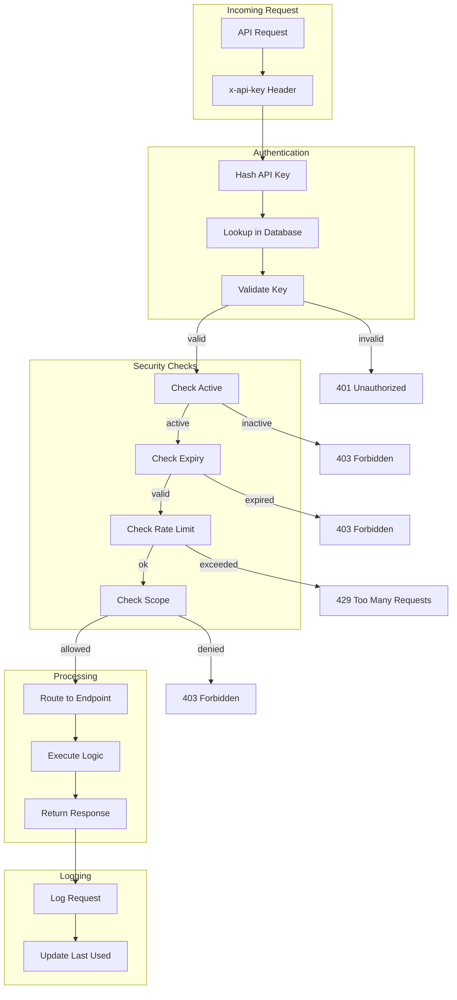
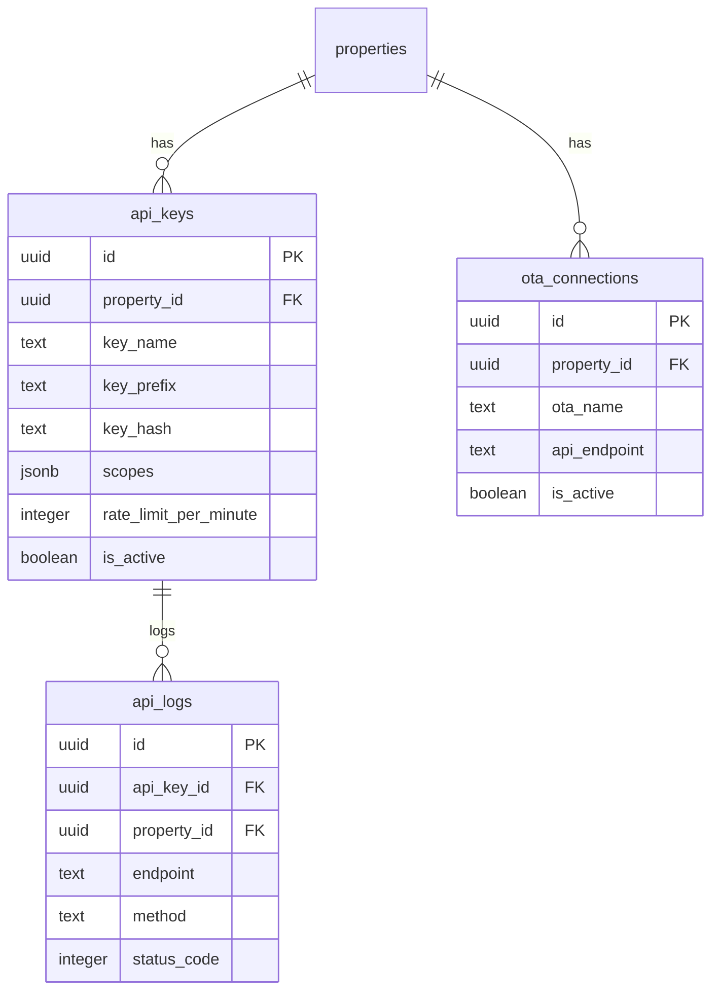

# API & Integration Module

## Overview

The API & Integration Module provides external system connectivity through a RESTful API for OTA (Online Travel Agency) integrations. It includes comprehensive API key management with scoped permissions, rate limiting, request logging, and secure authentication. The module enables third-party systems to check availability, retrieve rates, create reservations, and manage bookings.

---

## Level 1: Capabilities

1. **API Key Management** - Create and manage API keys with scoped permissions
2. **OTA API Endpoints** - RESTful API for availability, rates, and reservations
3. **Rate Limiting** - Protect the API from abuse with per-key rate limits
4. **Request Logging** - Comprehensive logging of all API requests
5. **OTA Connections** - Configure connections to external OTA platforms

---

## Level 2: Features

### 1. API Key Management
- **Key Creation**
  - Generate unique API keys per property
  - Key prefix for identification (first 8 chars)
  - SHA-256 hash storage (never store raw keys)
  - Key name for identification
  
- **Scope Configuration**
  - `availability:read` - Check room availability
  - `rates:read` - Retrieve rate information
  - `reservations:read` - View reservations
  - `reservations:write` - Create/modify reservations
  - `*` - Full access (all scopes)
  
- **Key Controls**
  - Active/inactive status
  - Expiration date (optional)
  - Last used timestamp tracking
  - Revocation capability
  
- **Rate Limits**
  - Per-minute request limit
  - Default: 60 requests/minute
  - Configurable per key

### 2. OTA API Endpoints
- **Availability Check (GET /availability)**
  - Required: check_in, check_out dates
  - Optional: site_type filter
  - Returns: available sites with details
  - Scope: `availability:read`
  
- **Rate Information (GET /rates)**
  - Returns: site types and rate plans
  - Includes seasonal pricing
  - Scope: `rates:read`
  
- **Create Reservation (POST /reservations)**
  - Guest information (email, name, phone)
  - Site selection
  - Date range
  - Total price
  - Source tracking
  - Scope: `reservations:write`
  
- **List Reservations (GET /reservations)**
  - Filter by confirmation number
  - Filter by status
  - Filter by date range
  - Pagination support
  - Scope: `reservations:read`
  
- **Update Reservation (PATCH /reservations/:id)**
  - Modify dates, status, guest count
  - Scope: `reservations:write`
  
- **Cancel Reservation (DELETE /reservations/:id)**
  - Sets status to CANCELLED
  - Scope: `reservations:write`

### 3. Rate Limiting
- **In-Memory Tracking**
  - Per-key request counter
  - 60-second rolling window
  - Resets after cold start
  
- **Limit Enforcement**
  - 429 status on exceed
  - Retry-After header
  - Configurable per key
  
- **Protection**
  - Prevents API abuse
  - Protects system resources

### 4. Request Logging
- **Log Details**
  - API key ID
  - Property ID
  - Endpoint path
  - HTTP method
  - Response status code
  - Response time (ms)
  - Request body (for writes)
  - Error message (if any)
  - Client IP address
  - User agent
  
- **Log Analysis**
  - Track usage patterns
  - Identify errors
  - Performance monitoring

### 5. OTA Connections
- **Connection Configuration**
  - OTA name (Booking.com, Expedia, etc.)
  - API endpoint URL
  - API key/credentials
  - Active/inactive status
  
- **Connection Management**
  - Add new connections
  - Update credentials
  - Disable connections

---

## Database Tables

| Table | Purpose |
|-------|---------|
| `api_keys` | API key storage and configuration |
| `api_logs` | Request logging |
| `ota_connections` | OTA connection configuration |

### Table Details

#### api_keys
| Column | Type | Description |
|--------|------|-------------|
| `id` | uuid | Primary key |
| `property_id` | uuid | FK to properties |
| `key_name` | text | Key display name |
| `key_prefix` | text | First 8 characters |
| `key_hash` | text | SHA-256 hash |
| `key_type` | text | standard/premium |
| `scopes` | jsonb | Allowed scopes array |
| `rate_limit_per_minute` | integer | Requests per minute |
| `expires_at` | timestamptz | Expiration (optional) |
| `last_used_at` | timestamptz | Last request time |
| `revoked_at` | timestamptz | Revocation time |
| `is_active` | boolean | Active status |
| `created_by` | uuid | Created by user |
| `created_at` | timestamptz | Creation timestamp |

#### api_logs
| Column | Type | Description |
|--------|------|-------------|
| `id` | uuid | Primary key |
| `api_key_id` | uuid | FK to api_keys |
| `property_id` | uuid | FK to properties |
| `method` | text | HTTP method |
| `endpoint` | text | Endpoint path |
| `status_code` | integer | Response status |
| `response_time_ms` | integer | Response time |
| `request_body` | jsonb | Request payload |
| `error_message` | text | Error if any |
| `ip_address` | text | Client IP |
| `user_agent` | text | User agent |
| `created_at` | timestamptz | Request timestamp |

#### ota_connections
| Column | Type | Description |
|--------|------|-------------|
| `id` | uuid | Primary key |
| `property_id` | uuid | FK to properties |
| `ota_name` | text | OTA name |
| `api_endpoint` | text | API endpoint URL |
| `api_key` | text | API credentials |
| `is_active` | boolean | Active status |
| `created_at` | timestamptz | Creation timestamp |
| `updated_at` | timestamptz | Last update |

---

## Dataflow

### API Request Flow



### Reservation Creation Flow (OTA)

```mermaid
flowchart LR
    subgraph ota [OTA System]
        OTA_REQ[Create Reservation Request]
    end
    
    subgraph api [API Processing]
        VALIDATE_KEY[Validate API Key]
        PARSE_BODY[Parse Request Body]
        VALIDATE_SITE[Validate Site Belongs to Property]
    end
    
    subgraph guest [Guest Handling]
        CHECK_GUEST[Check Existing Guest]
        CREATE_GUEST[Create Guest if New]
    end
    
    subgraph reservation [Reservation Creation]
        CREATE_RES[Create Reservation]
        GEN_CONF[Generate Confirmation]
    end
    
    subgraph response [Response]
        RETURN[Return Confirmation]
    end
    
    OTA_REQ --> VALIDATE_KEY --> PARSE_BODY --> VALIDATE_SITE
    VALIDATE_SITE --> CHECK_GUEST --> CREATE_GUEST
    CREATE_GUEST --> CREATE_RES --> GEN_CONF --> RETURN
```



---

## API Endpoints

### Authentication

All requests must include the API key in the header:

```
x-api-key: your_api_key_here
```

### Endpoints Reference

| Method | Endpoint | Scope | Description |
|--------|----------|-------|-------------|
| GET | /availability | availability:read | Check room availability |
| GET | /rates | rates:read | Get rate information |
| POST | /reservations | reservations:write | Create reservation |
| GET | /reservations | reservations:read | List reservations |
| PATCH | /reservations/:id | reservations:write | Update reservation |
| DELETE | /reservations/:id | reservations:write | Cancel reservation |

### Example Requests

**Check Availability**
```http
GET /ota-api/availability?check_in=2025-01-15&check_out=2025-01-20
x-api-key: hc_abc12345...
```

**Create Reservation**
```http
POST /ota-api/reservations
x-api-key: hc_abc12345...
Content-Type: application/json

{
  "guest": {
    "email": "guest@example.com",
    "first_name": "John",
    "last_name": "Doe",
    "phone": "+1-555-123-4567"
  },
  "site_id": "uuid-of-site",
  "check_in_date": "2025-01-15",
  "check_out_date": "2025-01-20",
  "total_price": 750.00,
  "source": "booking.com"
}
```

---

## Key Components

### Frontend Components
- `ApiKeysManagement.tsx` - API key management interface

### Edge Functions
- `ota-api` - OTA API endpoint handler
  - Handles all API routes
  - Performs authentication
  - Enforces rate limits
  - Logs all requests

---

## Scope Permissions

| Scope | Permissions |
|-------|-------------|
| `availability:read` | Check room availability |
| `rates:read` | View rate plans and pricing |
| `reservations:read` | View reservations |
| `reservations:write` | Create, update, cancel reservations |
| `*` | Full access (all scopes) |

---

## Relationships



---

## Integration Points

1. **Reservation Module** - Create and manage reservations
2. **Guest Module** - Guest profile lookup and creation
3. **Site Module** - Room availability checking
4. **Rate Module** - Rate plan information
5. **Property Module** - Property-scoped access

---

## Security Considerations

1. **Key Storage**
   - Raw keys never stored
   - SHA-256 hash only
   - Key prefix for identification
   
2. **Transport Security**
   - HTTPS required
   - TLS encryption
   
3. **Access Control**
   - Property-scoped keys
   - Scope-based permissions
   - Rate limiting
   
4. **Audit Trail**
   - All requests logged
   - IP tracking
   - Error logging

---

## Error Responses

| Status | Error | Description |
|--------|-------|-------------|
| 400 | Bad Request | Missing or invalid parameters |
| 401 | Unauthorized | Missing or invalid API key |
| 403 | Forbidden | Inactive key, expired, or missing scope |
| 404 | Not Found | Endpoint or resource not found |
| 429 | Too Many Requests | Rate limit exceeded |
| 500 | Internal Error | Server error |

---

## Rate Limit Headers

When approaching or exceeding limits:

```
Retry-After: 60
X-RateLimit-Limit: 60
X-RateLimit-Remaining: 0
X-RateLimit-Reset: 1704067200
```
