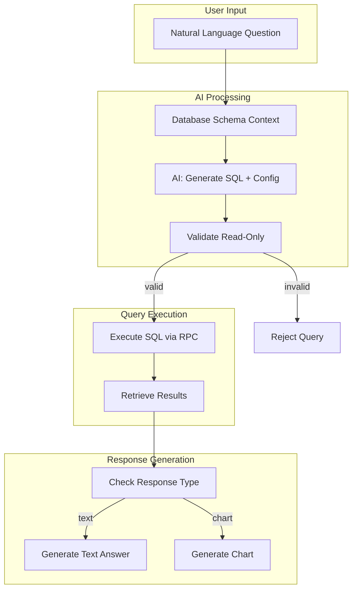
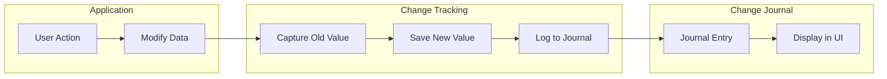
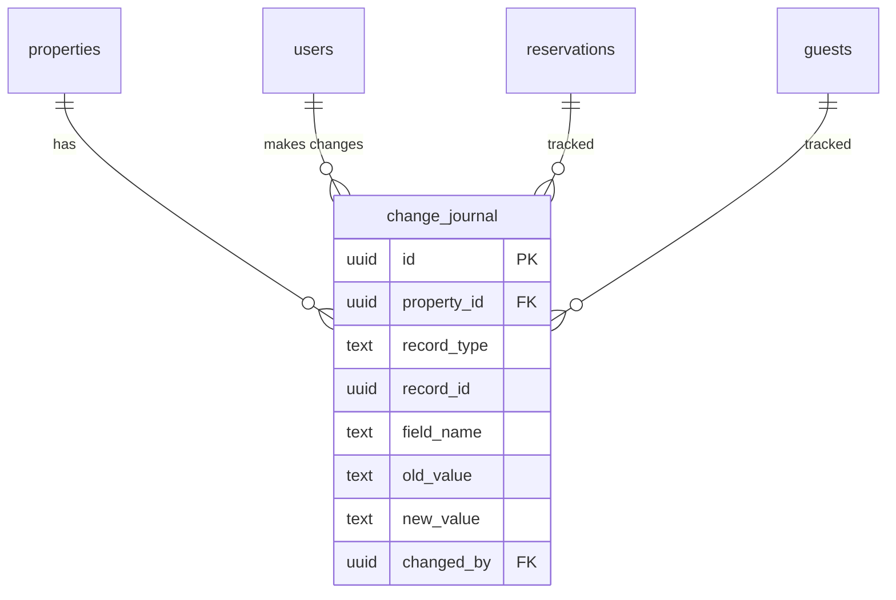

# Reporting & Analytics Module

## Overview

The Reporting & Analytics Module provides comprehensive reporting capabilities for property operations. It includes an AI-powered natural language query interface that allows users to ask questions about their data and receive responses with optional chart visualizations. The module also includes change journal tracking for auditing data modifications across the system.

---

## Level 1: Capabilities

1. **AI-Powered Reports Chat** - Natural language query interface for data analysis
2. **Change Journal** - Track and audit data modifications
3. **Standard Reports** - Pre-built reports for common analytics needs
4. **Data Visualization** - Chart-based data presentation
5. **Report Export** - Export data for external analysis

---

## Level 2: Features

### 1. AI-Powered Reports Chat
- **Natural Language Queries**
  - Ask questions in plain English
  - AI generates appropriate SQL queries
  - Results returned as text or charts
  
- **Supported Question Types**
  - Revenue analysis ("What was total revenue last month?")
  - Occupancy metrics ("What's our occupancy rate this week?")
  - Guest statistics ("How many new guests this quarter?")
  - Reservation trends ("Show me arrivals for next week")
  - Source analysis ("What percentage comes from OTAs?")
  
- **Response Types**
  - Text - Natural language answer
  - Chart - Visual data representation
  
- **Chart Types**
  - Bar charts - Comparative data
  - Line charts - Time series trends
  - Pie charts - Proportional data

### 2. Change Journal
- **Tracked Changes**
  - Record type (reservation, guest, etc.)
  - Record ID and identifier
  - Field name modified
  - Old value
  - New value
  - Changed by user
  - Timestamp
  
- **Journal Queries**
  - Filter by record type
  - Filter by date range
  - Filter by user
  - Search by record identifier
  
- **Retention**
  - Automatic purge after 45 days
  - Runs during day-end close
  - Property-specific cleanup

### 3. Standard Reports
- **Occupancy Reports**
  - Daily occupancy percentage
  - Room type breakdown
  - Trend analysis
  
- **Revenue Reports**
  - Daily/weekly/monthly revenue
  - Revenue by room type
  - Revenue by source
  
- **Guest Reports**
  - New vs. returning guests
  - Guest origin geography
  - Guest preferences
  
- **Accounting Reports**
  - Folio summaries
  - AR aging
  - Payment analysis

### 4. Data Visualization
- **Chart Configuration**
  - Automatic chart type selection
  - X-axis and Y-axis mapping
  - Chart titles
  
- **Chart Rendering**
  - Responsive design
  - Interactive elements
  - Color-coded data

### 5. Report Export
- **Export Formats**
  - CSV for spreadsheet analysis
  - JSON for programmatic access
  
- **Export Scope**
  - Full report data
  - Filtered subsets
  - Date range selection

---

## Database Tables

| Table | Purpose |
|-------|---------|
| `change_journal` | Data modification audit trail |

### Table Details

#### change_journal
| Column | Type | Description |
|--------|------|-------------|
| `id` | uuid | Primary key |
| `property_id` | uuid | FK to properties |
| `record_type` | text | Entity type (reservation, guest) |
| `record_id` | uuid | Entity ID |
| `record_identifier` | text | Human-readable ID (e.g., confirmation number) |
| `field_name` | text | Modified field |
| `old_value` | text | Previous value |
| `new_value` | text | New value |
| `changed_by` | uuid | User ID who made change |
| `changed_by_name` | text | User name |
| `created_at` | timestamptz | Change timestamp |

---

## Dataflow

### AI Reports Chat Flow



### Change Journal Tracking Flow



---

## AI Query Schema Context

The AI is provided with the following schema information:

```
TABLES:
- reservations: id, property_id, site_id, guest_id, check_in_date, 
  check_out_date, status, total_price, guests_count, adults_count, 
  children_count, rate_id, source_of_business_id, created_at

- guests: id, email, first_name, last_name, phone, city, state, 
  zipcode, created_at

- sites: id, property_id, site_type_id, site_number, max_occupancy, 
  is_active, amenities

- site_types: id, property_id, name, base_price, description

- rates: id, property_id, rate_code, description, start_date, 
  end_date, is_base_rate

- source_of_business: id, property_id, code, definition, is_default

- ledger_accounts: id, property_id, ledger_type, balance, guest_id, 
  reservation_id

- ledger_transactions: id, ledger_account_id, transaction_type, 
  debit_amount, credit_amount, description, transaction_date

- folio_postings: id, ledger_account_id, posting_type, amount, 
  description, posting_date

- night_audits: id, property_id, audit_date, status, 
  total_room_revenue, total_tax_revenue, total_payments

- dayend_closes: id, property_id, close_date, status, total_revenue, 
  total_taxes, total_payments
```

---

## AI Response Format

The AI returns JSON in this format:

```json
{
  "sql": "SELECT ... FROM ... WHERE ...",
  "responseType": "text | chart",
  "chartConfig": {
    "type": "bar | line | pie",
    "xKey": "column_name",
    "yKey": "column_name",
    "title": "Chart Title"
  },
  "explanation": "What this query does"
}
```

---

## Key Components

### Frontend Pages
- `Reports.tsx` - Main reports page with AI chat interface
- `ChangeJournal.tsx` - Change journal viewing page

### Frontend Components
- `AccountingReports.tsx` - Accounting-specific reports

### Edge Functions
- `reports-chat` - AI-powered query processing
  - Receives natural language questions
  - Generates SQL via AI (Gemini)
  - Executes read-only queries
  - Returns text or chart response

### Library Functions
- `changeJournal.ts` - Change journal utilities
- `exportUtils.ts` - Report export utilities

### Database Functions
- `execute_readonly_query(query_text)` - Execute read-only SQL

---

## Example Questions and Responses

### Revenue Question
**Q:** "What was total revenue last week?"

**AI SQL:**
```sql
SELECT SUM(total_price) as total_revenue 
FROM reservations 
WHERE check_in_date >= '2025-01-01' 
  AND check_in_date < '2025-01-08'
  AND status NOT IN ('CANCELLED', 'NO_SHOW')
```

**Response:** "Total revenue for last week was $12,450.00 across 42 reservations."

### Occupancy Chart
**Q:** "Show me daily occupancy for this month"

**AI Response:**
```json
{
  "responseType": "chart",
  "chartConfig": {
    "type": "line",
    "xKey": "date",
    "yKey": "occupancy_percent",
    "title": "Daily Occupancy - January 2025"
  }
}
```

---

## Relationships



---

## Integration Points

1. **All Modules** - Change journal tracks changes across system
2. **Reservation Module** - Reservation analytics
3. **Accounting Module** - Financial reports
4. **Guest Module** - Guest statistics
5. **Housekeeping Module** - Productivity metrics
6. **Night Audit** - Daily summaries

---

## Security Considerations

1. **Read-Only Enforcement**
   - AI queries validated for SELECT only
   - INSERT/UPDATE/DELETE rejected
   - DROP/ALTER/TRUNCATE rejected
   
2. **Property Isolation**
   - Queries scoped to user's property
   - RLS enforced on all tables
   
3. **Query Limits**
   - Maximum 1000 rows returned
   - Timeout protection
   
4. **Rate Limiting**
   - AI API rate limits respected
   - User feedback on limits

---

## Change Journal Record Types

| Record Type | Description |
|-------------|-------------|
| `reservation` | Reservation modifications |
| `guest` | Guest profile changes |
| `site` | Room/site updates |
| `rate` | Rate plan changes |
| `ledger` | Ledger account changes |
| `folio_posting` | Folio posting modifications |
| `housekeeping` | Housekeeping changes |

---

## Report Export Options

### CSV Export
- Column headers included
- Comma-separated values
- UTF-8 encoding
- Date format: YYYY-MM-DD

### JSON Export
- Full data structure
- Nested objects preserved
- ISO date formats
- Pretty-printed option
