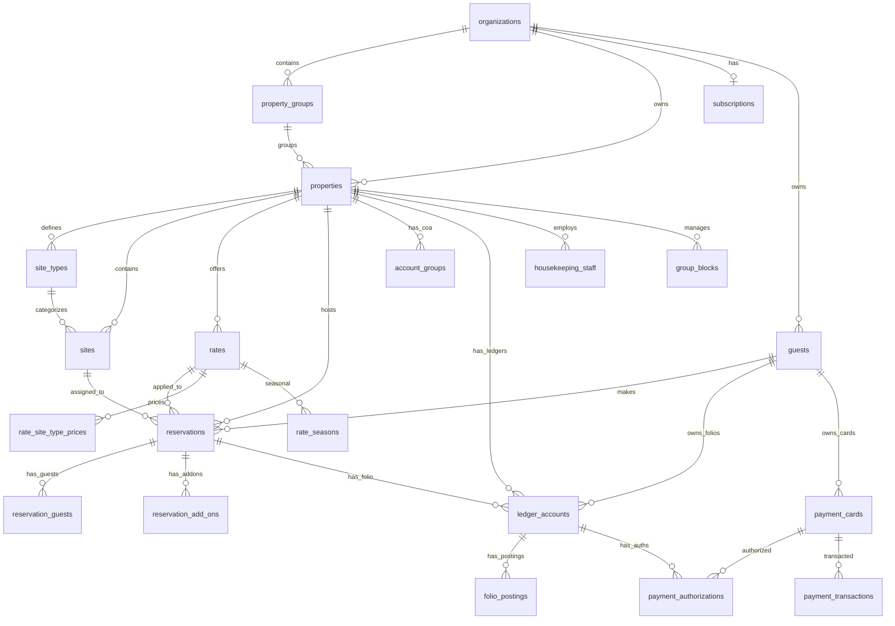
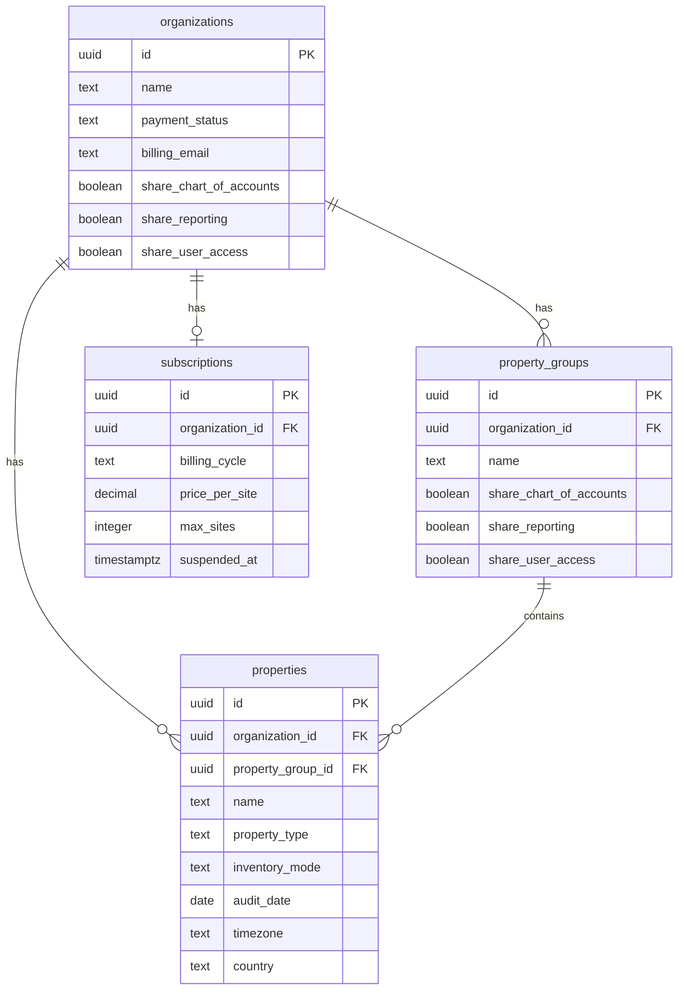
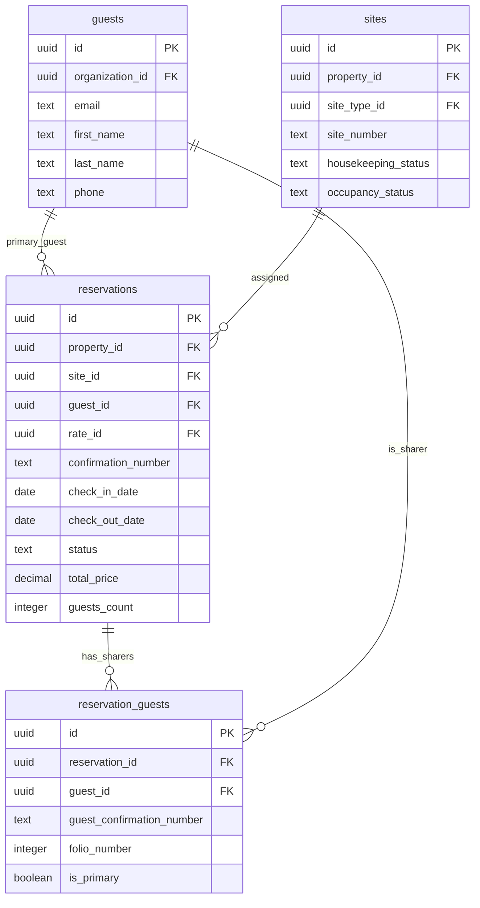
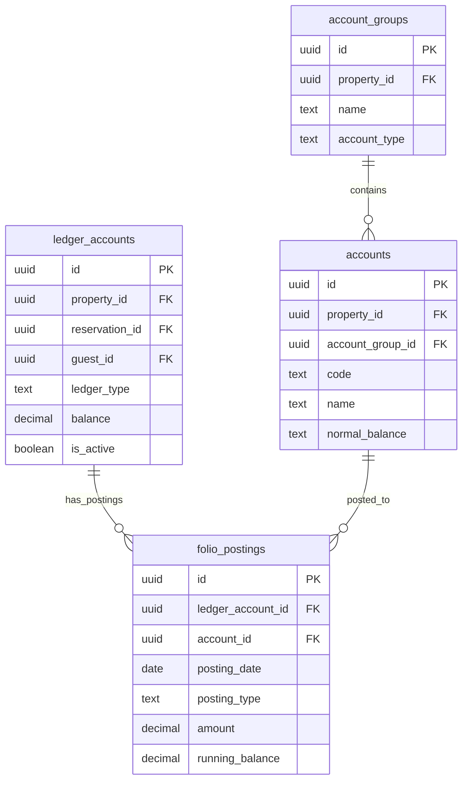
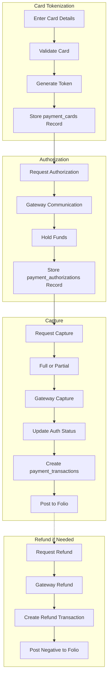
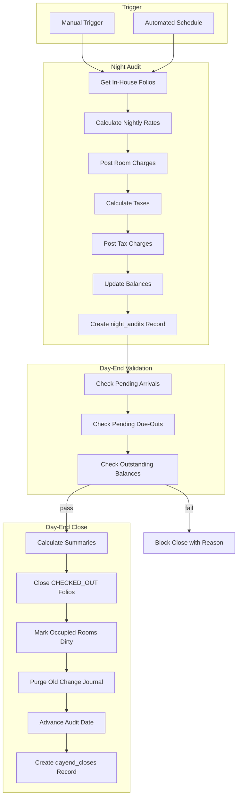
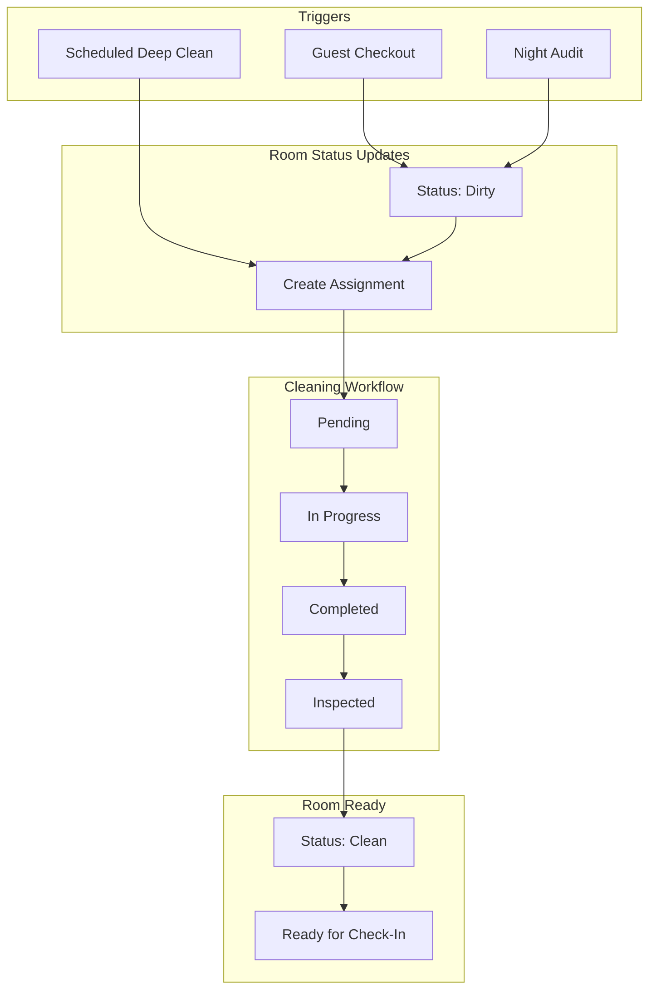
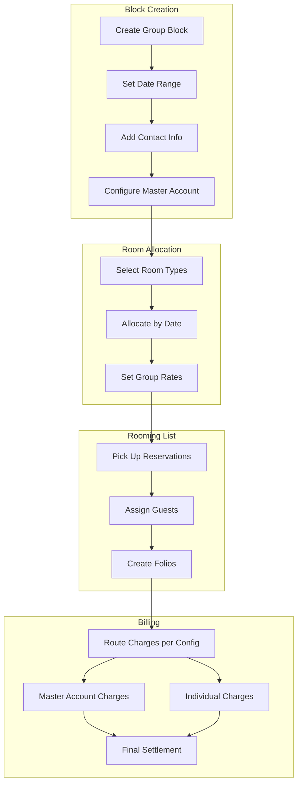

# Database Breakdown & Dataflow

## Overview

This document provides a comprehensive breakdown of the Happy Camper BnB database schema, organized by functional module. It includes the complete table inventory, entity relationships, and dataflow diagrams for key processes.

---

## Table of Contents

1. [Complete Table Inventory](#complete-table-inventory)
2. [Entity-Relationship Diagram](#entity-relationship-diagram)
3. [Tables by Module](#tables-by-module)
4. [Key Process Dataflows](#key-process-dataflows)
5. [Database Enums](#database-enums)
6. [Database Functions](#database-functions)

---

## Complete Table Inventory

The database consists of **54 tables** organized across 14 functional modules:

| # | Table Name | Module | Purpose |
|---|------------|--------|---------|
| 1 | `organizations` | Property & Organization | Top-level tenant entities |
| 2 | `property_groups` | Property & Organization | Property groupings |
| 3 | `properties` | Property & Organization | Individual property configuration |
| 4 | `subscriptions` | Property & Organization | Billing and subscription management |
| 5 | `site_types` | Site/Room Management | Room/site category definitions |
| 6 | `sites` | Site/Room Management | Individual room/site inventory |
| 7 | `seasons` | Site/Room Management | Seasonal period definitions |
| 8 | `reservations` | Reservation Management | Core reservation records |
| 9 | `reservation_guests` | Reservation Management | Multiple guests per reservation |
| 10 | `reservation_add_ons` | Reservation Management | Add-ons attached to reservations |
| 11 | `reservation_recommendations` | Reservation Management | AI-generated recommendations |
| 12 | `source_of_business` | Reservation Management | Booking source definitions |
| 13 | `property_confirmation_sequences` | Reservation Management | Confirmation number generation |
| 14 | `guests` | Guest Management | Guest profile information |
| 15 | `guest_room_preferences` | Guest Management | Room preference records |
| 16 | `guest_sharing_groups` | Guest Management | Cross-property sharing groups |
| 17 | `guest_sharing_group_members` | Guest Management | Properties in sharing groups |
| 18 | `rates` | Rate & Pricing | Rate plan definitions |
| 19 | `rate_site_type_prices` | Rate & Pricing | Per-room-type pricing |
| 20 | `rate_seasons` | Rate & Pricing | Seasonal adjustments |
| 21 | `rate_add_ons` | Rate & Pricing | Bundled add-ons |
| 22 | `rate_rules` | Rate & Pricing | Dynamic pricing rules |
| 23 | `add_ons` | Rate & Pricing | Ancillary products/services |
| 24 | `guarantee_options` | Rate & Pricing | Reservation guarantee types |
| 25 | `account_groups` | Accounting | Chart of Accounts categories |
| 26 | `accounts` | Accounting | General ledger accounts |
| 27 | `account_taxes` | Accounting | Tax configuration |
| 28 | `ledger_accounts` | Accounting | Guest folios and AR accounts |
| 29 | `folio_postings` | Accounting | Transaction postings |
| 30 | `ledger_transactions` | Accounting | Ledger account transactions |
| 31 | `journal_entries` | Accounting | Manual journal entry headers |
| 32 | `journal_entry_lines` | Accounting | Journal entry line items |
| 33 | `city_ledger_invoices` | Accounting | AR invoices |
| 34 | `city_ledger_invoice_payments` | Accounting | Payments applied to invoices |
| 35 | `folio_split_rules` | Accounting | Folio splitting configuration |
| 36 | `folio_split_rule_allocations` | Accounting | Split allocations per guest |
| 37 | `statement_sends` | Accounting | AR statement email log |
| 38 | `payment_cards` | Payment Processing | Tokenized payment cards |
| 39 | `payment_authorizations` | Payment Processing | Authorization holds |
| 40 | `payment_transactions` | Payment Processing | Payment transaction records |
| 41 | `housekeeping_staff` | Housekeeping | Staff member records |
| 42 | `housekeeping_zones` | Housekeeping | Zone/floor definitions |
| 43 | `housekeeping_assignments` | Housekeeping | Room cleaning assignments |
| 44 | `cleaning_preferences` | Housekeeping | Property cleaning settings |
| 45 | `room_type_cleaning_times` | Housekeeping | Cleaning time per room type |
| 46 | `user_roles` | User & Security | Global user role assignments |
| 47 | `user_property_access` | User & Security | User access to properties |
| 48 | `custom_roles` | User & Security | Property-specific roles |
| 49 | `user_custom_roles` | User & Security | User-to-role assignments |
| 50 | `login_attempts` | User & Security | Login attempt tracking |
| 51 | `user_lockouts` | User & Security | Account lockout records |
| 52 | `user_password_history` | User & Security | Password change history |
| 53 | `security_audit_logs` | User & Security | Security event logging |
| 54 | `staff_profiles` | User & Security | Staff user profiles |
| 55 | `staff_activity_log` | User & Security | Staff activity tracking |
| 56 | `group_blocks` | Group Blocks | Group block headers |
| 57 | `group_block_room_allocations` | Group Blocks | Per-date room allocations |
| 58 | `group_block_payment_cards` | Group Blocks | Group payment cards |
| 59 | `campaigns` | CRM & Marketing | Campaign definitions |
| 60 | `campaign_sends` | CRM & Marketing | Send tracking records |
| 61 | `night_audits` | Night Audit | Night audit processing records |
| 62 | `night_audit_settings` | Night Audit | Auto-run configuration |
| 63 | `dayend_closes` | Night Audit | Day-end close records |
| 64 | `auto_run_logs` | Night Audit | Automated processing logs |
| 65 | `api_keys` | API & Integration | API key storage |
| 66 | `api_logs` | API & Integration | Request logging |
| 67 | `ota_connections` | API & Integration | OTA connection config |
| 68 | `change_journal` | Reporting & Analytics | Data modification audit trail |

---

## Entity-Relationship Diagram

### Core System ERD



### Organization & Property Hierarchy



### Reservation & Guest Flow



### Accounting & Ledger Flow



---

## Tables by Module

### Module 1: Property & Organization
- `organizations` - Tenant entities
- `property_groups` - Property groupings
- `properties` - Individual properties
- `subscriptions` - Billing management

### Module 2: Site/Room Management
- `site_types` - Room categories
- `sites` - Room inventory
- `seasons` - Seasonal periods

### Module 3: Reservation Management
- `reservations` - Core reservations
- `reservation_guests` - Multi-guest support
- `reservation_add_ons` - Add-on attachments
- `reservation_recommendations` - AI recommendations
- `source_of_business` - Booking sources
- `property_confirmation_sequences` - Confirmation numbers

### Module 4: Guest Management
- `guests` - Guest profiles
- `guest_room_preferences` - Room preferences
- `guest_sharing_groups` - Cross-property sharing
- `guest_sharing_group_members` - Sharing group members

### Module 5: Rate & Pricing
- `rates` - Rate plans
- `rate_site_type_prices` - Per-type pricing
- `rate_seasons` - Seasonal adjustments
- `rate_add_ons` - Bundled add-ons
- `rate_rules` - Dynamic pricing
- `add_ons` - Ancillary products
- `guarantee_options` - Guarantee types

### Module 6: Accounting
- `account_groups` - COA categories
- `accounts` - GL accounts
- `account_taxes` - Tax configuration
- `ledger_accounts` - Folios and AR
- `folio_postings` - Transactions
- `ledger_transactions` - Ledger transactions
- `journal_entries` - Manual entries
- `journal_entry_lines` - Entry lines
- `city_ledger_invoices` - AR invoices
- `city_ledger_invoice_payments` - Invoice payments
- `folio_split_rules` - Split rules
- `folio_split_rule_allocations` - Allocations
- `statement_sends` - Statement log

### Module 7: Payment Processing
- `payment_cards` - Tokenized cards
- `payment_authorizations` - Auth holds
- `payment_transactions` - Transactions

### Module 8: Housekeeping
- `housekeeping_staff` - Staff records
- `housekeeping_zones` - Zone definitions
- `housekeeping_assignments` - Assignments
- `cleaning_preferences` - Settings
- `room_type_cleaning_times` - Cleaning times

### Module 9: User & Security
- `user_roles` - Role assignments
- `user_property_access` - Property access
- `custom_roles` - Custom roles
- `user_custom_roles` - Role assignments
- `login_attempts` - Login tracking
- `user_lockouts` - Lockout records
- `user_password_history` - Password history
- `security_audit_logs` - Audit logs
- `staff_profiles` - Staff profiles
- `staff_activity_log` - Activity log

### Module 10: Group Blocks
- `group_blocks` - Block headers
- `group_block_room_allocations` - Allocations
- `group_block_payment_cards` - Payment cards

### Module 11: CRM & Marketing
- `campaigns` - Campaign definitions
- `campaign_sends` - Send tracking

### Module 12: Night Audit
- `night_audits` - Audit records
- `night_audit_settings` - Auto-run config
- `dayend_closes` - Close records
- `auto_run_logs` - Processing logs

### Module 13: API & Integration
- `api_keys` - API keys
- `api_logs` - Request logs
- `ota_connections` - OTA connections

### Module 14: Reporting & Analytics
- `change_journal` - Audit trail

---

## Key Process Dataflows

### 1. Complete Reservation Lifecycle

```mermaid
flowchart TB
    subgraph booking [Booking Phase]
        B1[Select Property]
        B2[Choose Dates]
        B3[Select Guest]
        B4[Select Room/Type]
        B5[Apply Rate]
        B6[Add Add-Ons]
        B7[Generate Quote]
        B8[Confirm Reservation]
    end
    
    subgraph pre_arrival [Pre-Arrival]
        P1[Send Pre-Arrival Campaign]
        P2[Capture Payment Card]
        P3[Create Authorization]
        P4[Assign Room]
    end
    
    subgraph checkin [Check-In Phase]
        C1[Verify Guest]
        C2[Confirm Room]
        C3[Create Guest Folio]
        C4[Transfer Deposits]
        C5[Issue Key]
    end
    
    subgraph inhouse [In-House Phase]
        I1[Post Room Charges - Night Audit]
        I2[Post Tax Charges]
        I3[Post Add-On Charges]
        I4[Post Incidental Charges]
    end
    
    subgraph checkout [Check-Out Phase]
        O1[Review Folio]
        O2[Settle Balance]
        O3[Capture Payment]
        O4[Close Folio]
        O5[Update Room Status]
    end
    
    subgraph post [Post-Departure]
        D1[Send Post-Departure Campaign]
        D2[Transfer to City Ledger if Balance]
        D3[Create Invoice]
    end
    
    B1 --> B2 --> B3 --> B4 --> B5 --> B6 --> B7 --> B8
    B8 --> P1 --> P2 --> P3 --> P4
    P4 --> C1 --> C2 --> C3 --> C4 --> C5
    C5 --> I1 --> I2 --> I3 --> I4
    I4 --> O1 --> O2 --> O3 --> O4 --> O5
    O5 --> D1 --> D2 --> D3
```



### 2. Payment Processing Flow



### 3. Night Audit & Day-End Flow



### 4. Housekeeping Workflow



### 5. Group Block Lifecycle



---

## Database Enums

### reservation_status
```sql
CREATE TYPE reservation_status AS ENUM (
  'PENDING',
  'CONFIRMED', 
  'CHECKED_IN',
  'CHECKED_OUT',
  'CANCELLED',
  'NO_SHOW'
);
```

### property_type
```sql
CREATE TYPE property_type AS ENUM (
  'campground',
  'hotel'
);
```

### inventory_mode
```sql
CREATE TYPE inventory_mode AS ENUM (
  'unit_required',
  'type_floating'
);
```

### account_type
```sql
CREATE TYPE account_type AS ENUM (
  'asset',
  'liability',
  'equity',
  'revenue',
  'expense',
  'tax'
);
```

### ledger_type
```sql
CREATE TYPE ledger_type AS ENUM (
  'advance_deposit',
  'guest',
  'city'
);
```

### transaction_type
```sql
CREATE TYPE transaction_type AS ENUM (
  'payment',
  'charge',
  'transfer',
  'refund',
  'adjustment'
);
```

### app_role
```sql
CREATE TYPE app_role AS ENUM (
  'super_admin',
  'internal_admin',
  'admin',
  'manager',
  'front_desk',
  'sales',
  'support',
  'finance'
);
```

### housekeeping_status
```sql
CREATE TYPE housekeeping_status AS ENUM (
  'clean',
  'dirty',
  'needs_inspection',
  'out_of_order'
);
```

### occupancy_status
```sql
CREATE TYPE occupancy_status AS ENUM (
  'vacant',
  'occupied'
);
```

### cleaning_type
```sql
CREATE TYPE cleaning_type AS ENUM (
  'stayover',
  'departure',
  'deep_clean'
);
```

### assignment_status
```sql
CREATE TYPE assignment_status AS ENUM (
  'pending',
  'in_progress',
  'completed',
  'inspected',
  'declined'
);
```

---

## Database Functions

### Access Control Functions

| Function | Purpose |
|----------|---------|
| `has_role(_role, _user_id)` | Check if user has specified role |
| `is_super_admin()` | Check if current user is super admin |
| `is_org_admin(_organization_id)` | Check org admin status |
| `user_can_access_property(_property_id)` | Verify property access |
| `user_has_property_access(_property_id)` | Check property access |

### Operational Functions

| Function | Purpose |
|----------|---------|
| `mark_occupied_rooms_dirty(p_property_id)` | Mark all occupied rooms dirty |
| `execute_readonly_query(query_text)` | Execute read-only SQL for reports |
| `can_access_guest(_guest_id, _property_id)` | Check guest access |

### Triggers

| Trigger | Table | Purpose |
|---------|-------|---------|
| `update_running_balance` | `folio_postings` | Maintain running balance |
| `update_ledger_balance` | `ledger_accounts` | Update ledger balance |
| `log_security_event` | Various | Audit logging |

---

## Row Level Security (RLS)

All tables have Row Level Security enabled with property-level isolation:

1. **Property Isolation** - Users can only access data for properties they have access to
2. **Organization Isolation** - Data is scoped to the user's organization
3. **Super Admin Bypass** - Super admins have access to all data
4. **Policy Types**:
   - SELECT policies for read access
   - INSERT policies for create access
   - UPDATE policies for modify access
   - DELETE policies for remove access

Example RLS Policy:
```sql
CREATE POLICY "Users can view reservations for their properties"
ON reservations FOR SELECT
USING (
  property_id IN (
    SELECT property_id FROM user_property_access
    WHERE user_id = auth.uid()
  )
  OR is_super_admin()
);
```
