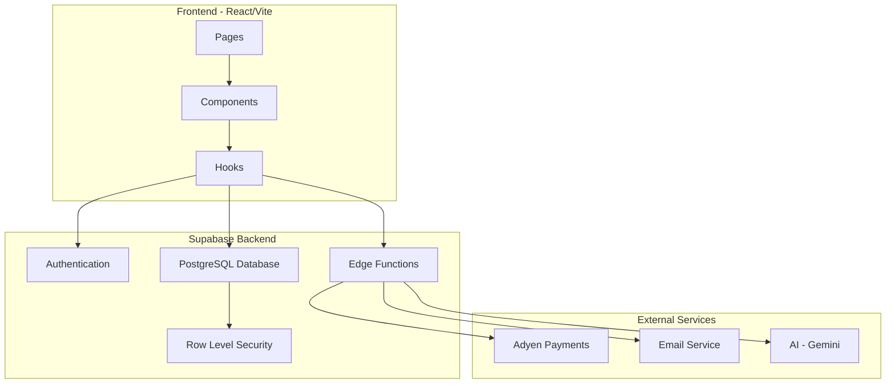
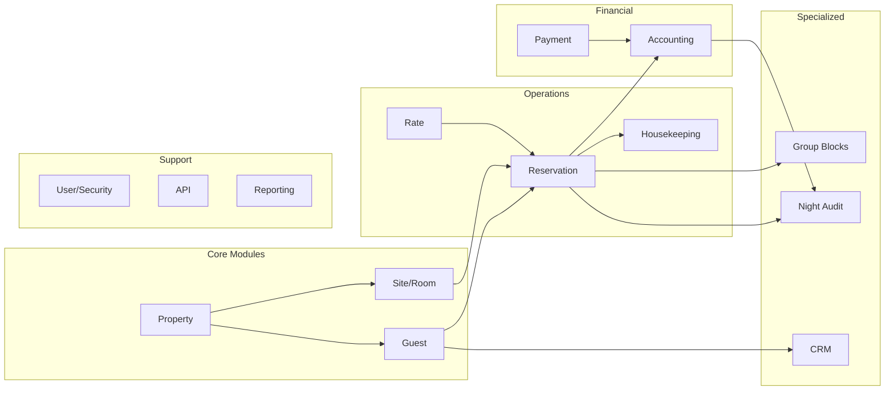

# Happy Camper BnB - Module Documentation

This directory contains comprehensive documentation for the Happy Camper BnB Property Management System (PMS), organized by functional modules.

---

## System Overview

Happy Camper BnB is a cloud-based Property Management System built on Supabase, designed for hotels, RV parks, and campgrounds. The system is organized into **14 functional modules** that work together to provide end-to-end hospitality management.

---

## Module Index

| # | Module | File | Description |
|---|--------|------|-------------|
| 1 | [Property & Organization](01-property-organization.md) | `01-property-organization.md` | Multi-tenant organization and property management |
| 2 | [Site/Room Management](02-site-room-management.md) | `02-site-room-management.md` | Room inventory, types, and map configuration |
| 3 | [Reservation Management](03-reservation-management.md) | `03-reservation-management.md` | Booking lifecycle from creation to checkout |
| 4 | [Guest Management](04-guest-management.md) | `04-guest-management.md` | Guest profiles and cross-property sharing |
| 5 | [Rate & Pricing](05-rate-pricing.md) | `05-rate-pricing.md` | Rate plans, seasonal pricing, and add-ons |
| 6 | [Accounting](06-accounting.md) | `06-accounting.md` | Chart of accounts, folios, and AR management |
| 7 | [Payment Processing](07-payment-processing.md) | `07-payment-processing.md` | Card tokenization, authorizations, and captures |
| 8 | [Housekeeping](08-housekeeping.md) | `08-housekeeping.md` | Staff, zones, and cleaning assignments |
| 9 | [User & Security](09-user-security.md) | `09-user-security.md` | RBAC, MFA, and audit logging |
| 10 | [Group Blocks](10-group-blocks.md) | `10-group-blocks.md` | Group reservations and master billing |
| 11 | [CRM & Marketing](11-crm-marketing.md) | `11-crm-marketing.md` | Campaigns and automated guest communication |
| 12 | [Night Audit](12-night-audit.md) | `12-night-audit.md` | Night audit and day-end close processing |
| 13 | [API & Integration](13-api-integration.md) | `13-api-integration.md` | OTA API and external integrations |
| 14 | [Reporting & Analytics](14-reporting-analytics.md) | `14-reporting-analytics.md` | AI reports chat and change journal |

---

## Database Documentation

| Document | Description |
|----------|-------------|
| [DATABASE_BREAKDOWN.md](DATABASE_BREAKDOWN.md) | Complete database schema, entity relationships, and dataflow diagrams |

---

## Document Structure

Each module document follows a consistent structure:

```
# Module Name

## Overview
Brief description of the module purpose

## Level 1: Capabilities
- High-level capability list

## Level 2: Features
### Capability 1
- Detailed features

## Database Tables
| Table | Purpose |
|-------|---------|

## Dataflow
Mermaid diagrams showing data flow

## Key Components
- Frontend pages
- Edge functions
- Database functions

## Relationships
Entity-relationship diagrams

## Integration Points
How the module connects with others
```

---

## Architecture Overview



---

## Module Dependencies



---

## Quick Reference

### Key Database Tables

| Table | Module | Purpose |
|-------|--------|---------|
| `properties` | Property | Property configuration |
| `sites` | Site/Room | Room inventory |
| `reservations` | Reservation | Booking records |
| `guests` | Guest | Guest profiles |
| `rates` | Rate | Rate plans |
| `ledger_accounts` | Accounting | Guest folios |
| `payment_cards` | Payment | Tokenized cards |
| `housekeeping_assignments` | Housekeeping | Cleaning tasks |
| `user_roles` | User/Security | Access control |
| `group_blocks` | Group Blocks | Group bookings |
| `campaigns` | CRM | Marketing campaigns |
| `night_audits` | Night Audit | Daily processing |
| `api_keys` | API | External access |
| `change_journal` | Reporting | Audit trail |

### Key Edge Functions

| Function | Module | Purpose |
|----------|--------|---------|
| `create-user` | User/Security | User creation via Admin API |
| `process-payment` | Payment | Card processing |
| `payment-config` | Payment | Gateway configuration |
| `get-recommendations` | Reservation | AI site recommendations |
| `send-statement` | Accounting | AR statement emails |
| `process-campaigns` | CRM | Automated campaign sending |
| `auto-dayend-close` | Night Audit | Automated day-end |
| `ota-api` | API | External OTA endpoints |
| `reports-chat` | Reporting | AI-powered queries |

---

## Technology Stack

| Layer | Technology |
|-------|------------|
| Frontend | React 18, Vite, TypeScript |
| UI Components | shadcn/ui, Tailwind CSS |
| State Management | TanStack Query |
| Backend | Supabase (PostgreSQL) |
| Authentication | Supabase Auth |
| Edge Functions | Deno/TypeScript |
| Payment Gateway | Adyen |
| AI | Google Gemini |

---

## Getting Started

1. **New to the system?** Start with [Property & Organization](01-property-organization.md) to understand the multi-tenant architecture.

2. **Understanding reservations?** Read [Reservation Management](03-reservation-management.md) for the complete booking lifecycle.

3. **Working on financials?** Review [Accounting](06-accounting.md) and [Payment Processing](07-payment-processing.md).

4. **Database design?** See [DATABASE_BREAKDOWN.md](DATABASE_BREAKDOWN.md) for the complete schema.

---

## Contributing

When updating module documentation:

1. Maintain the consistent document structure
2. Update Mermaid diagrams when flows change
3. Keep table inventories current
4. Cross-reference related modules in Integration Points
5. Update this README if adding new modules
